# koldconvert Design System

You are building UI for **koldconvert**. Dark-themed, warm palette, sans-serif typography (Arial), compact density on a 4px grid.

## Visual Reference

**IMPORTANT**: Study ALL screenshots below before writing any UI. Match colors, typography, spacing, layout, and motion exactly as shown.

### Homepage

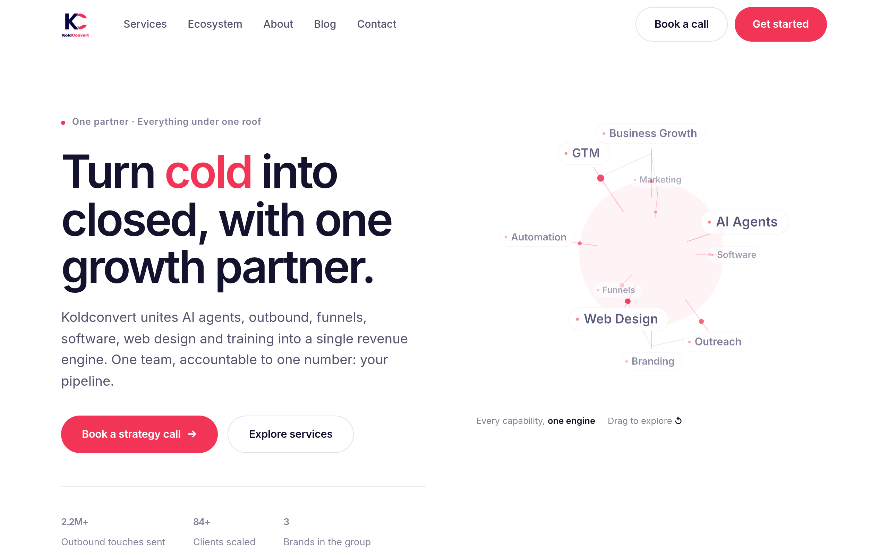

### Scroll Journey (Cinematic Visual States)

> These screenshots capture the website at different scroll depths. The design changes dramatically as you scroll — each frame shows a different cinematic state. Replicate these exact visual transitions.

#### 0% — Hero / Above the fold

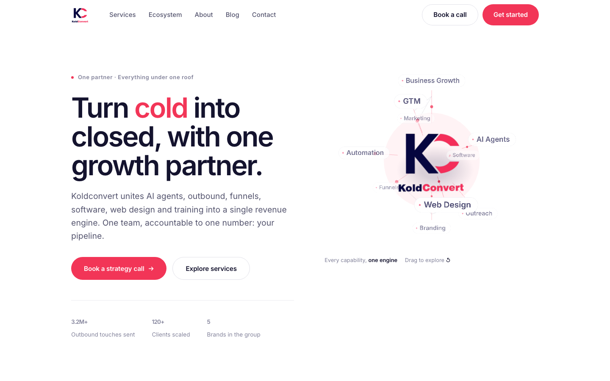

#### 17% — Mid-page at 17% scroll

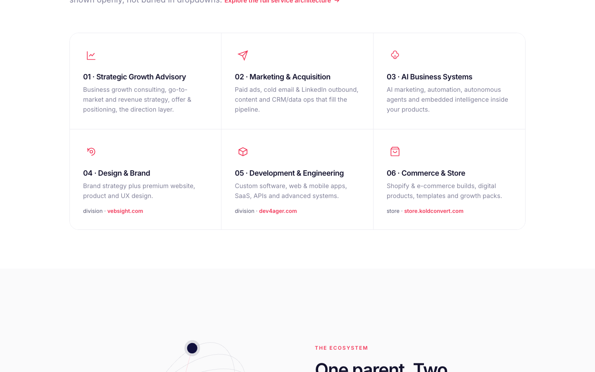

#### 33% — Mid-page at 33% scroll

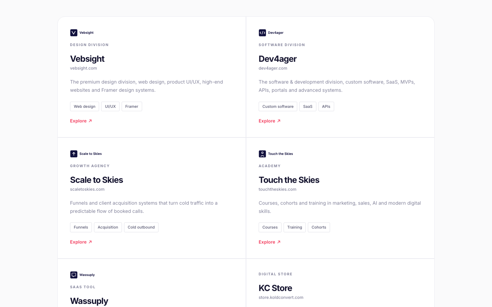

#### 50% — Mid-page at 50% scroll

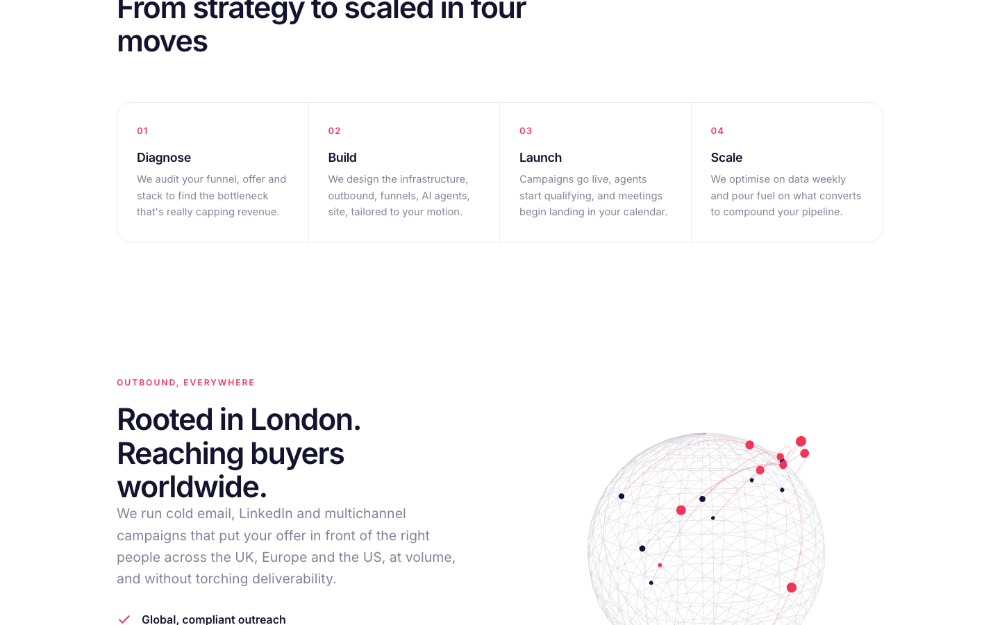

#### 67% — Mid-page at 67% scroll

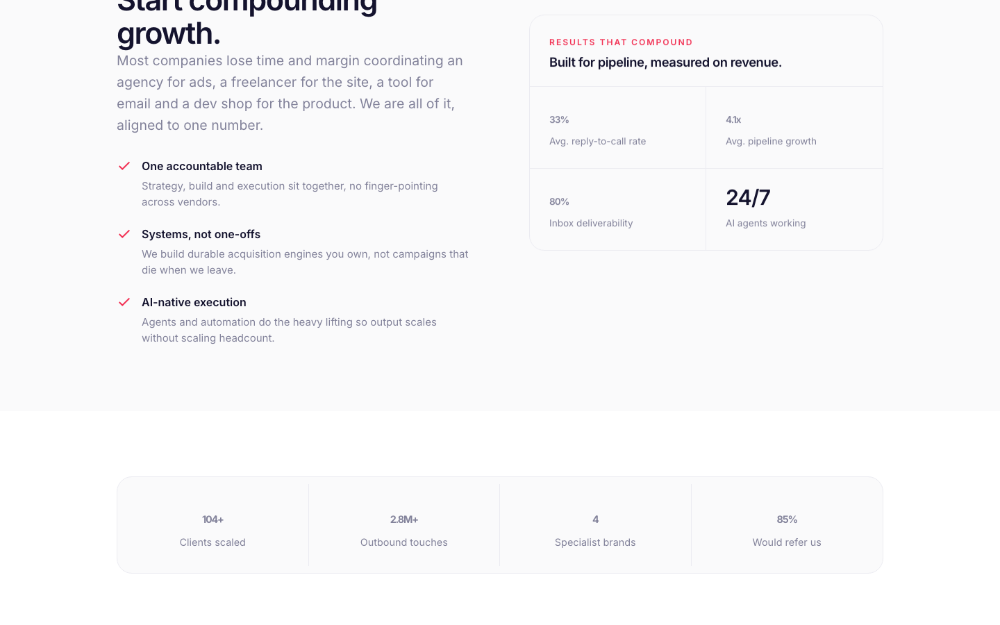

#### 83% — Mid-page at 83% scroll

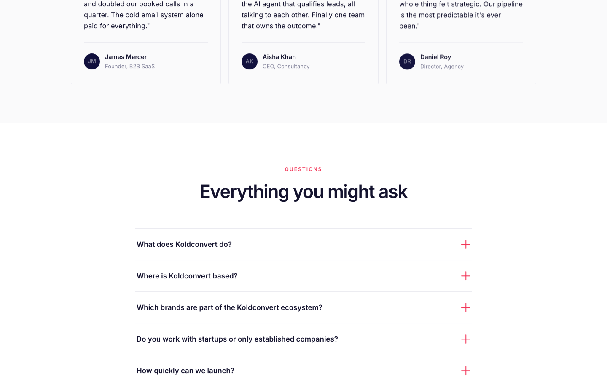

#### 100% — Footer / End of page

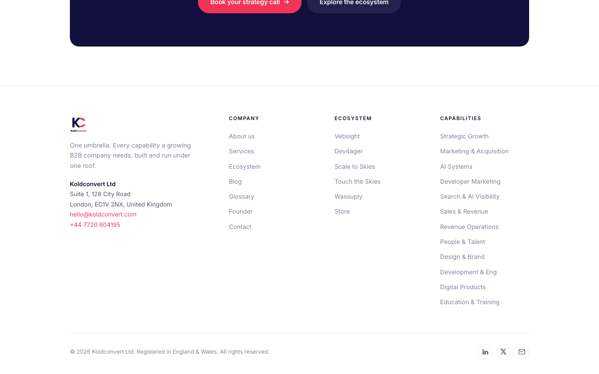

> Read `references/DESIGN.md` for full token details. Read `references/ANIMATIONS.md` for motion specs. Read `references/LAYOUT.md` for layout structure. Read `references/COMPONENTS.md` for component patterns.

## Ultra Reference Files

This package includes extended documentation. **Read these files before implementing:**

| File | Contents |
|------|----------|
| `references/DESIGN.md` | Full design system tokens, colors, typography, spacing |
| `references/VISUAL_GUIDE.md` | **START HERE** — Master visual guide with all screenshots embedded |
| `references/ANIMATIONS.md` | CSS keyframes, scroll triggers, motion library stack, video specs |
| `references/LAYOUT.md` | Flex/grid containers, page structure, spacing relationships |
| `references/COMPONENTS.md` | DOM component patterns, HTML structure, class fingerprints |
| `references/INTERACTIONS.md` | Hover/focus states with before/after style diffs |
| `screens/scroll/` | 7 scroll journey screenshots showing cinematic states |

## Design Philosophy

- **Layered depth** — use shadow tokens to create a sense of physical layering. Each elevation level has a specific shadow.
- **Gradient accents** — gradients are used thoughtfully for emphasis, not decoration.
- **Type pairing** — Arial for body/UI text, Inter for headings/display. Never introduce a third typeface.
- **compact density** — 4px base grid. Every dimension is a multiple of 4.
- **warm palette** — the color temperature runs warm, matching the sans-serif typography.
- **Restrained accent** — `#f23557` is the only pop of color. Used exclusively for CTAs, links, focus rings, and active states.
- **Subtle motion** — transitions smooth state changes. Keep durations under 300ms, use ease-out curves.

## Color System

### Core Palette

| Role | Token | Hex | Use |
|------|-------|-----|-----|
| Background | `--background` | `#14132e` | Page/app background |
| Surface | `--surface` | `#f6f6f9` | Cards, panels, modals |
| Text Primary | `--text-primary` | `#ebebf1` | Headings, body text |
| Text Muted | `--text-muted` | `#54546e` | Captions, placeholders |
| Accent | `--accent` | `#f23557` | CTAs, links, focus rings |
| Border | `--border` | `#444444` | Dividers, card borders |

### Status Colors

| Status | Hex | Use |
|--------|-----|-----|
| Success | `#4cd964` | Confirmations, positive trends |
| Danger | `#c0392b` | Errors, destructive actions |

### Extended Palette

- `#82829a`
- `#e0e0e8` — Light surface or highlight color
- `#232255`
- `#000000` — Deep background layer or shadow color
- `#3a2a6e`
- `#b6b6c6`

### CSS Variable Tokens

```css
--accent: #f23557;
--accent-700: #d81e45;
--card: #f6f6f9;
--accent: #f23557;
--accent-700: #d81e45;
--card: #f6f6f9;
--accent: #f23557;
--accent-700: #d81e45;
--card: #f6f6f9;
--accent: #f23557;
--accent-700: #d81e45;
--card: #f6f6f9;
```

## Typography

### Font Stack

- **Arial** — Heading 1, Heading 2, Heading 3
- **Inter** — Body, Caption

### Font Sources

```css
@font-face {
  font-family: "Inter";
  src: url("fonts/Inter-Bold.ttf") format("truetype");
  font-weight: 700;
}
@font-face {
  font-family: "Inter";
  src: url("fonts/Inter-Regular.ttf") format("truetype");
  font-weight: 400;
}
```

### Type Scale

| Role | Family | Size | Weight |
|------|--------|------|--------|
| Heading 1 | Arial | 3.4rem | 700 |
| Heading 2 | Arial | clamp(2.5rem,5.4vw,4.1rem) | 700 |
| Heading 3 | Arial | clamp(2.1rem,4.6vw,3.3rem) | 700 |
| Body | Inter | .92rem | 400 |
| Caption | Inter | .82rem | 400 |

### Typography Rules

- Body/UI: **Arial**, Headings: **Inter** — these are the only display fonts
- Max 3-4 font sizes per screen
- Headings: weight 600-700, body: weight 400
- Use color and opacity for text hierarchy, not additional font sizes
- Line height: 1.5 for body, 1.2 for headings

## Spacing & Layout

### Base Grid: 4px

Every dimension (margin, padding, gap, width, height) must be a multiple of **4px**.

### Spacing Scale

`2, 4, 6, 8, 10, 12, 14, 16, 18, 20, 22, 24` px

### Spacing as Meaning

| Spacing | Use |
|---------|-----|
| 4-8px | Tight: related items (icon + label, avatar + name) |
| 12-16px | Medium: between groups within a section |
| 24-32px | Wide: between distinct sections |
| 48px+ | Vast: major page section breaks |

### Border Radius

Scale: `2px, 3px, 4px, 8px, 12px, 14px, 22px, 999px`
Default: `12px`

### Container

Max-width: `1100px`, centered with auto margins.

### Breakpoints

| Name | Value |
|------|-------|
| xs | 460px |
| xs | 480px |
| sm | 560px |
| sm | 561px |
| sm | 600px |
| sm | 640px |
| md | 680px |
| md | 700px |
| md | 760px |
| lg | 820px |
| lg | 880px |
| lg | 940px |
| lg | 941px |
| xl | 1100px |

Mobile-first: design for small screens, layer on responsive overrides.

## Component Patterns

### Card

```css
.card {
  background: #f6f6f9;
  border: 1px solid #444444;
  border-radius: 12px;
  padding: 16px;
  box-shadow: 0 12px 48px rgba(0,0,0,.12);
}
```

```html
<div class="card">
  <h3>Card Title</h3>
  <p>Card content goes here.</p>
</div>
```

### Button

```css
/* Primary */
.btn-primary {
  background: #f23557;
  color: #ebebf1;
  border-radius: 12px;
  padding: 8px 16px;
  font-weight: 500;
  transition: opacity 150ms ease;
}
.btn-primary:hover { opacity: 0.9; }

/* Ghost */
.btn-ghost {
  background: transparent;
  border: 1px solid #444444;
  color: #ebebf1;
  border-radius: 12px;
  padding: 8px 16px;
}
```

```html
<button class="btn-primary">Get Started</button>
<button class="btn-ghost">Learn More</button>
```

### Input

```css
.input {
  background: #14132e;
  border: 1px solid #444444;
  border-radius: 12px;
  padding: 8px 12px;
  color: #ebebf1;
  font-size: 14px;
}
.input:focus { border-color: #f23557; outline: none; }
```

```html
<input class="input" type="text" placeholder="Search..." />
```

### Badge / Chip

```css
.badge {
  display: inline-flex;
  align-items: center;
  padding: 4px 8px;
  border-radius: 9999px;
  font-size: 12px;
  font-weight: 500;
  background: #f6f6f9;
  color: #54546e;
}
```

```html
<span class="badge">New</span>
<span class="badge">Beta</span>
```

### Modal / Dialog

```css
.modal-backdrop { background: rgba(0, 0, 0, 0.6); }
.modal {
  background: #f6f6f9;
  border: 1px solid #444444;
  border-radius: 999px;
  padding: 24px;
  max-width: 480px;
  width: 90vw;
  box-shadow: 0 12px 48px rgba(0,0,0,.12);
}
```

```html
<div class="modal-backdrop">
  <div class="modal">
    <h2>Dialog Title</h2>
    <p>Dialog content.</p>
    <button class="btn-primary">Confirm</button>
    <button class="btn-ghost">Cancel</button>
  </div>
</div>
```

### Table

```css
.table { width: 100%; border-collapse: collapse; }
.table th {
  text-align: left;
  padding: 8px 12px;
  font-weight: 500;
  font-size: 12px;
  color: #54546e;
  text-transform: uppercase;
  letter-spacing: 0.05em;
  border-bottom: 1px solid #444444;
}
.table td {
  padding: 12px;
  border-bottom: 1px solid #444444;
}
```

```html
<table class="table">
  <thead><tr><th>Name</th><th>Status</th><th>Date</th></tr></thead>
  <tbody>
    <tr><td>Item One</td><td>Active</td><td>Jan 1</td></tr>
    <tr><td>Item Two</td><td>Pending</td><td>Jan 2</td></tr>
  </tbody>
</table>
```

### Navigation

```css
.nav {
  display: flex;
  align-items: center;
  gap: 8px;
  padding: 12px 16px;
  border-bottom: 1px solid #444444;
}
.nav-link {
  color: #54546e;
  padding: 8px 12px;
  border-radius: 12px;
  transition: color 150ms;
}
.nav-link:hover { color: #ebebf1; }
.nav-link.active { color: #f23557; }
```

```html
<nav class="nav">
  <a href="/" class="nav-link active">Home</a>
  <a href="/about" class="nav-link">About</a>
  <a href="/pricing" class="nav-link">Pricing</a>
  <button class="btn-primary" style="margin-left: auto">Get Started</button>
</nav>
```

### Extracted Components

These components were found in the codebase:

**Button** (`html`)
- Variants: `primary`, `lg`

## Page Structure

The following page sections were detected:

- **Hero** — Hero/banner section with headline and CTAs
- **Features** — Feature/benefit cards grid (12 items)
- **Faq** — FAQ/accordion section
- **Cta** — Call-to-action section
- **Testimonials** — Testimonials/reviews section

When building pages, follow this section order and structure.

## Animation & Motion

This project uses **subtle motion**. Transitions smooth state changes without calling attention.

### Motion Tokens

- **Duration scale:** `.001ms`, `150ms`, `180ms`, `200ms`, `220ms`, `250ms`, `300ms`, `350ms`, `700ms`
- **Easing functions:** `ease`, `cubic-bezier(.2,.7,.3,1)`
- **Animated properties:** `background`, `color`, `border-color`, `transform`

### Motion Guidelines

- **Duration:** Use values from the duration scale above. Short (.001ms) for micro-interactions, long (700ms) for page transitions
- **Easing:** Use `ease` as the default easing curve
- **Direction:** Elements enter from bottom/right, exit to top/left
- **Reduced motion:** Always respect `prefers-reduced-motion` — disable animations when set

## Depth & Elevation

### Shadow Tokens

- Overlay (modals, dialogs): `0 12px 48px rgba(0,0,0,.12)`
- Overlay (modals, dialogs): `rgba(0, 0, 0, 0.12) 0px 12px 48px 0px`

### Z-Index Scale

`98, 100, 500`

Use these exact values — never invent z-index values.

## Anti-Patterns (Never Do)

- **No blur effects** — no backdrop-blur, no filter: blur()
- **No zebra striping** — tables and lists use borders for separation
- **No invented colors** — every hex value must come from the palette above
- **No arbitrary spacing** — every dimension is a multiple of 4px
- **No extra fonts** — only Arial and Inter are allowed
- **No arbitrary border-radius** — use the scale: 2px, 3px, 4px, 8px, 12px, 14px, 22px, 999px
- **No opacity for disabled states** — use muted colors instead

## Workflow

1. **Read** `references/DESIGN.md` before writing any UI code
2. **Pick colors** from the Color System section — never invent new ones
3. **Set typography** — Arial, Inter only, using the type scale
4. **Build layout** on the 4px grid — check every margin, padding, gap
5. **Match components** to patterns above before creating new ones
6. **Apply elevation** — use shadow tokens
7. **Validate** — every value traces back to a design token. No magic numbers.

## Brand Spec

- **Favicon:** `assets/favicon.svg`
- **Site URL:** `https://koldconvert.com/`
- **Brand color:** `#f23557`
- **Brand typeface:** Arial

## Quick Reference

```
Background:     #14132e
Surface:        #f6f6f9
Text:           #ebebf1 / #54546e
Accent:         #f23557
Border:         #444444
Font:           Arial
Spacing:        4px grid
Radius:         12px
Components:     7 detected
```

## When to Trigger

Activate this skill when:
- Creating new components, pages, or visual elements for koldconvert
- Writing CSS, Tailwind classes, styled-components, or inline styles
- Building page layouts, templates, or responsive designs
- Reviewing UI code for design consistency
- The user mentions "koldconvert" design, style, UI, or theme
- Generating mockups, wireframes, or visual prototypes

---

# Full Reference Files

> Every output file is embedded below. Claude has full design system context from /skills alone.

## Design System Tokens (DESIGN.md)

# koldconvert DESIGN.md

> Auto-generated design system — reverse-engineered via static analysis by skillui.
> Frameworks: None detected
> Colors: 17 · Fonts: 2 · Components: 7
> Icon library: not detected · State: not detected
> Primary theme: dark · Dark mode toggle: no · Motion: subtle

## Visual Reference

**Match this design exactly** — study colors, fonts, spacing, and component shapes before writing any UI code.


---

## 1. Visual Theme & Atmosphere

This is a **dark-themed** interface with a warm tone. Depth is expressed through layered shadows and subtle surface color variation. Typography pairs **Inter** for display/headings with **Arial** for body text, creating clear visual hierarchy through type contrast. Spacing follows a **4px base grid** (compact density), with scale: 2, 4, 6, 8, 10, 12, 14, 16px. The accent color **#f23557** anchors interactive elements (buttons, links, focus rings). Motion is subtle — smooth transitions (150-300ms) ease state changes without drawing attention.

---

## 2. Color Palette & Roles

| Token | Hex | Role | Use |
|---|---|---|---|
| background | `#14132e` | background | Page background, darkest surface |
| card | `#f6f6f9` | surface | Card and panel backgrounds |
| surface | `#11103d` | surface | Card and panel backgrounds |
| text-primary | `#ebebf1` | text-primary | Headings and body text |
| text-muted | `#54546e` | text-muted | Captions, placeholders, secondary info |
| border | `#444444` | border | Dividers, card borders, outlines |
| accent | `#f23557` | accent | CTAs, links, focus rings, active states |
| accent-700 | `#d81e45` | accent | CTAs, links, focus rings, active states |
| accent | `#7a2a5e` | accent | CTAs, links, focus rings, active states |
| danger | `#c0392b` | danger | Error states, destructive actions |
| success | `#4cd964` | success | Success states, positive indicators |
| info | `#232255` | info | Informational highlights |
| unknown | `#82829a` | unknown | Palette color |
| unknown | `#e0e0e8` | unknown | Palette color |
| unknown | `#000000` | unknown | Palette color |
| unknown | `#3a2a6e` | unknown | Palette color |
| unknown | `#b6b6c6` | unknown | Palette color |

### CSS Variable Tokens

```css
--accent: #f23557;
--accent-700: #d81e45;
--card: #f6f6f9;
--accent: #f23557;
--accent-700: #d81e45;
--card: #f6f6f9;
--accent: #f23557;
--accent-700: #d81e45;
--card: #f6f6f9;
--accent: #f23557;
--accent-700: #d81e45;
--card: #f6f6f9;
```


---

## 3. Typography Rules

**Font Stack:**
- **Arial** — Heading 1, Heading 2, Heading 3
- **Inter** — Body, Caption

**Font Sources:**

```css
@font-face {
  font-family: "Inter";
  src: url("fonts/Inter-Bold.ttf") format("truetype");
  font-weight: 700;
}
@font-face {
  font-family: "Inter";
  src: url("fonts/Inter-Regular.ttf") format("truetype");
  font-weight: 400;
}
```

| Role | Font | Size | Weight |
|---|---|---|---|
| Heading 1 | Arial | 3.4rem | 700 |
| Heading 2 | Arial | clamp(2.5rem,5.4vw,4.1rem) | 700 |
| Heading 3 | Arial | clamp(2.1rem,4.6vw,3.3rem) | 700 |
| Body | Inter | .92rem | 400 |
| Caption | Inter | .82rem | 400 |

**Typographic Rules:**
- Limit to 2 font families max per screen
- Use **Arial** for body/UI text, **Inter** for display/headings
- Maintain consistent hierarchy: no more than 3-4 font sizes per screen
- Headings use bold (600-700), body uses regular (400)
- Line height: 1.5 for body text, 1.2 for headings
- Use color and opacity for secondary hierarchy, not additional font sizes


---

## 4. Component Stylings

### Data Display (3)

**Card** — `html`

**Badge** — `html`

**List** — `html`

### Data Input (2)

**Button** — `html`
- Variants: `primary`, `lg`
- Animation: 

**Input** — `html`
- State: :focus, :placeholder

### Media (2)

**Image** — `html`

**Icon** — `html`


---

## 5. Layout Principles

- **Base spacing unit:** 4px
- **Spacing scale:** 2, 4, 6, 8, 10, 12, 14, 16, 18, 20, 22, 24
- **Border radius:** 2px, 3px, 4px, 8px, 12px, 14px, 22px, 999px
- **Max content width:** 1100px

**Spacing as Meaning:**
| Spacing | Use |
|---|---|
| 4-8px | Tight: related items within a group |
| 12-16px | Medium: between groups |
| 24-32px | Wide: between sections |
| 48px+ | Vast: major section breaks |


---

## 6. Depth & Elevation

### Overlay — full-screen overlays, top-level dialogs

- `0 12px 48px rgba(0,0,0,.12)`
- `rgba(0, 0, 0, 0.12) 0px 12px 48px 0px`

### Z-Index Scale

`98, 100, 500`


---

## 7. Animation & Motion

This project uses **subtle motion**. Transitions smooth state changes without demanding attention.

### Animated Components

- **Button**: 

### Motion Guidelines

- Duration: 150-300ms for micro-interactions, 300-500ms for page transitions
- Easing: `ease-out` for enters, `ease-in` for exits
- Always respect `prefers-reduced-motion`


---

## 8. Do's and Don'ts

### Do's

- Use `#f23557` for interactive elements (buttons, links, focus rings)
- Use `#14132e` as the primary page background
- Pair **Arial** (body) with **Inter** (display) — these are the only allowed fonts
- Follow the **4px** spacing grid for all margins, padding, and gaps
- Use the defined shadow tokens for elevation — see Section 6
- Use border-radius from the scale: 2px, 3px, 4px, 8px, 12px
- Reuse existing components from Section 4 before creating new ones

### Don'ts

- Don't introduce colors outside this palette — extend the design tokens first
- Don't introduce additional font families beyond Arial and Inter
- Don't use arbitrary spacing values — stick to multiples of 4px
- Don't create custom box-shadow values outside the system tokens
- Don't use arbitrary border-radius values — pick from the defined scale
- Don't duplicate component patterns — check Section 4 first
- Don't use backdrop-blur or blur effects

### Anti-Patterns (detected from codebase)

- No blur or backdrop-blur effects
- No zebra striping on tables/lists


---

## 9. Responsive Behavior

| Name | Value | Source |
|---|---|---|
| xs | 460px | css |
| xs | 480px | css |
| sm | 560px | css |
| sm | 561px | css |
| sm | 600px | css |
| sm | 640px | css |
| md | 680px | css |
| md | 700px | css |
| md | 760px | css |
| lg | 820px | css |
| lg | 880px | css |
| lg | 940px | css |
| lg | 941px | css |
| xl | 1100px | css |

**Approach:** Use `@media (min-width: ...)` queries matching the breakpoints above.


---

## 10. Agent Prompt Guide

Use these as starting points when building new UI:

### Build a Card

```
Background: #f6f6f9
Border: 1px solid #444444
Radius: 12px
Padding: 16px
Font: Arial
Use shadow tokens from Section 6.
```

### Build a Button

```
Primary: bg #f23557, text white
Ghost: bg transparent, border #444444
Padding: 8px 16px
Radius: 12px
Hover: opacity 0.9 or lighter shade
Focus: ring with #f23557
```

### Build a Page Layout

```
Background: #14132e
Max-width: 1100px, centered
Grid: 4px base
Responsive: mobile-first, breakpoints from Section 9
```

### Build a Stats Card

```
Surface: #f6f6f9
Label: #54546e (muted, 12px, uppercase)
Value: #ebebf1 (primary, 24-32px, bold)
Status: use success/warning/danger from Section 2
```

### Build a Form

```
Input bg: #14132e
Input border: 1px solid #444444
Focus: border-color #f23557
Label: #54546e 12px
Spacing: 16px between fields
Radius: 12px
```

### General Component

```
1. Read DESIGN.md Sections 2-6 for tokens
2. Colors: only from palette
3. Font: Arial, type scale from Section 3
4. Spacing: 4px grid
5. Components: match patterns from Section 4
6. Elevation: shadow tokens
```

## Visual Guide — Screenshots (VISUAL_GUIDE.md)

# koldconvert — Visual Guide

> Master visual reference. Study every screenshot carefully before implementing any UI.
> Match colors, layout, typography, spacing, and motion states exactly.

**WebGL/3D:** Detected (3 canvas elements) — replicate with Three.js or CSS 3D transforms

## Scroll Journey

The page has cinematic scroll animations. Each screenshot below shows the exact visual state at that scroll depth.
**Replicate these transitions precisely** — the design changes dramatically as you scroll.

### Hero — Above the fold

*Scroll position: 0px of 8884px total*


### 17% scroll depth

*Scroll position: 1357px of 8884px total*


### 33% scroll depth

*Scroll position: 2635px of 8884px total*


### 50% scroll depth

*Scroll position: 3992px of 8884px total*


### 67% scroll depth

*Scroll position: 5349px of 8884px total*


### 83% scroll depth

*Scroll position: 6627px of 8884px total*


### Footer — End of page

*Scroll position: 7984px of 8884px total*


## Full Page Screenshots

### Koldconvert | AI, Marketing & Software Agency in London, Everything Under One Roof

*URL: `https://koldconvert.com/`*


### 403 Forbidden

*URL: `https://koldconvert.com/services`*


### Strategic Growth Advisory | Business Consulting London | Koldconvert

*URL: `https://koldconvert.com/services/strategic-growth/`*


### Business Growth Consulting | Diagnostics & Strategy London | Koldconvert

*URL: `https://koldconvert.com/services/strategic-growth/business-growth-consulting`*


### Go-To-Market Strategy | GTM Planning London | Koldconvert

*URL: `https://koldconvert.com/services/strategic-growth/go-to-market-revenue-strategy`*


## Section Screenshots

Clipped sections showing individual components in context.

### Section 1 — `section`

*1440×835px*


### Section 1 — `section`

*1440×693px*


### Section 2 — `section`

*1440×957px*


### Section 1 — `section`

*1440×724px*


### Section 2 — `section`

*1440×601px*


### Section 1 — `section`

*1440×665px*


### Section 2 — `section`

*1440×632px*


## Animations & Motion (ANIMATIONS.md)

# Animation Reference

> Cinematic motion design extracted from live DOM. Follow these specs exactly to recreate the experience.

## Motion Technology Stack

| Library | Type | Notes |
|---------|------|-------|
| Canvas (3 elements) | WebGL/3D | WebGL context detected — likely Three.js or custom shader |

## Scroll Journey

The page is **8,884px** tall. Each frame below shows what the user sees at that scroll depth.

> **Use these screenshots to understand WHAT animates, WHEN it animates, and HOW it moves.**

### 0% — Top / Hero
Scroll position: 0px


### 17% — Opening Section
Scroll position: 1,357px


### 33% — First Feature Section
Scroll position: 2,635px


### 50% — Mid-Page
Scroll position: 3,992px


### 67% — Lower Content
Scroll position: 5,349px


### 83% — Near Footer
Scroll position: 6,627px


### 100% — Bottom / Footer
Scroll position: 7,984px


## Global Transition Declarations

These `transition` values were extracted from CSS rules across the site:

```css
transition: background 0.2s, color 0.2s, border-color 0.2s, transform 0.2s;
transition: transform 0.2s;
transition: border-color 0.3s;
transition: color 0.2s;
transition: background 0.3s;
transition: transform 0.3s;
transition: opacity 0.22s, visibility 0.22s, transform 0.22s;
transition: color 0.15s;
transition: transform 0.25s;
transition: max-height 0.35s;
transition: width 0.2s;
transition: color 0.25s;
```

## How to Recreate This Motion Design

### Step 2 — Scroll-Reveal Pattern

Elements that animate into view follow this pattern:

```css
/* Initial hidden state */
.reveal {
  opacity: 0;
  transform: translateY(40px);
  transition: opacity 0.2s cubic-bezier(0.4, 0, 0.2, 1),
              transform 0.2s cubic-bezier(0.4, 0, 0.2, 1);
}
.reveal.visible {
  opacity: 1;
  transform: translateY(0);
}
```

### Step 3 — Key Motion Principles

- **WebGL/3D layer detected** — product visualizations use Three.js or custom WebGL. Use `<canvas>` with Three.js for 3D product renders
- **Canvas elements (3)** — animated via requestAnimationFrame loop. Use canvas for particle effects, gradient animations, and WebGL scenes
- **Duration scale:** `0.2s` — use these values, never invent new durations
- **Always add** `@media (prefers-reduced-motion: reduce) { * { animation-duration: 0.01ms !important; transition-duration: 0.01ms !important; } }`

### Step 4 — Scroll Journey Reference

Match what happens at each scroll position:

- **0%** (`0px`) → `screens/scroll/scroll-000.png`
- **17%** (`1357px`) → `screens/scroll/scroll-017.png`
- **33%** (`2635px`) → `screens/scroll/scroll-033.png`
- **50%** (`3992px`) → `screens/scroll/scroll-050.png`
- **67%** (`5349px`) → `screens/scroll/scroll-067.png`
- **83%** (`6627px`) → `screens/scroll/scroll-083.png`
- **100%** (`7984px`) → `screens/scroll/scroll-100.png`

## Layout & Grid (LAYOUT.md)

# Layout Reference

> Auto-extracted from live DOM. Use this to understand how the site is structured spatially.

## Spacing System

**Base grid:** 4px

**Scale:** `2, 4, 6, 8, 10, 12, 14, 16, 18, 20, 22, 24, 26, 28, 30` px

| Spacing | Semantic Use |
|---------|-------------|
| 4px | Tight — within a component |
| 8px | Medium — between sibling items |
| 16px | Wide — between sections |
| 32px | Vast — major section breaks |

## Flex Layouts

| Element | Direction | Justify | Align | Gap | Children |
|---------|-----------|---------|-------|-----|----------|
| `div.container.nav-inner` | row | — | center | 28px | 3 |
| `nav.nav-links` | row | — | center | 2px | 5 |

## Grid Layouts

| Element | Template Columns | Gap | Children |
|---------|-----------------|-----|----------|
| `div.container.hero-grid` | `526.312px 505.688px` | 72px | 2 |
| `div.container.split` | `510px 510px` | 84px | 2 |
| `div.eco-grid` | `550px 550px` | 2px | 6 |
| `div.cards.reveal` | `367.328px 367.328px 367.344px` | 0px | 6 |

## Structural Containers

### `<header>` (`header.nav`)

```
display:          block
children:         1
```

### `<main>` 

```
display:          block
children:         11
```

### `<footer>` (`footer.footer`)

```
display:          block
padding:          72px 0px 36px
children:         1
```

### `<section>` (`section.hero`)

```
display:          block
padding:          96px 0px 104px
children:         1
```

### `<section>` (`section.logos`)

```
display:          block
padding:          44px 0px
children:         1
```

### `<section>` (`section#services`)

```
display:          block
padding:          93.6px 0px
children:         1
```

### `<section>` (`section#ecosystem.bg-soft`)

```
display:          block
padding:          93.6px 0px
children:         1
```

### `<section>` (`section#process`)

```
display:          block
padding:          93.6px 0px
children:         1
```

### `<section>` 

```
display:          block
padding:          93.6px 0px
children:         1
```

### `<section>` (`section.bg-soft`)

```
display:          block
padding:          93.6px 0px
children:         1
```

### `<section>` 

```
display:          block
padding:          93.6px 0px
children:         1
```

### `<section>` (`section.bg-soft`)

```
display:          block
padding:          93.6px 0px
children:         1
```

## Layout Rules

- **Container max-width:** `1160px` — always center with `margin: auto`
- Primary layout system: **Flexbox**
- Secondary layout system: **CSS Grid** (used for card grids and multi-column layouts)
- Every spacing value must be a multiple of **4px**
- Never use arbitrary margin/padding values outside the spacing scale

## Component Patterns (COMPONENTS.md)

# Component Reference

> Repeated DOM patterns detected by structural analysis. Each component appeared 3+ times.

## Detected Components

| Component | Category | Instances | Key Classes |
|-----------|----------|-----------|-------------|
| **Eyebrow** | unknown | 8× | `.eyebrow` |
| **H2** | unknown | 8× |  |
| **Container** | unknown | 6× | `.container` |
| **Card** | card | 6× | `.card` |
| **Ico** | unknown | 6× | `.ico` |
| **Eco Name** | unknown | 6× | `.eco-name` |
| **Eco Domain** | unknown | 6× | `.eco-domain` |
| **Eco Tags** | badge | 6× | `.eco-tags` |
| **Visit** | unknown | 6× | `.visit` |
| **Mega Col** | unknown | 5× | `.mega-col` |
| **Eco Card** | card | 5× | `.eco-card`, `.reveal` |
| **Eco Logo** | unknown | 5× | `.eco-logo` |
| **Step** | unknown | 4× | `.step` |
| **Num** | unknown | 4× | `.num` |
| **Stat** | unknown | 3× | `.stat` |
| **Scene3d** | unknown | 3× | `.scene3d` |
| **Via** | unknown | 3× | `.via` |
| **Bg Soft** | unknown | 3× | `.bg-soft` |
| **Lead** | unknown | 3× | `.lead`, `.muted` |
| **Container** | unknown | 3× | `.container` |

## Cards

### Card

**Instances found:** 6

**CSS classes:** `.card`

**HTML structure:**

```html
<article class="card"> <div class="ico"><svg viewBox="0 0 24 24" fill="none" stroke="currentColor" stroke-width="1.6"><path d="M3 3v18h18"></path><path d="m7 14 4-4 3 3 5-6"></path></svg></div> <h3>01 · Strategic Growth Advisory</h3> <p>Business growth consulting, go-to-market…</p> </article>
```

**Base styles (from design tokens):**

```css
.card {
  background: #f6f6f9;
  border: 1px solid #444444;
  border-radius: 12px;
  padding: 8px;
}```

### Eco Card

**Instances found:** 5

**CSS classes:** `.eco-card` `.reveal`

**HTML structure:**

```html
<a href="ecosystem.html" class="eco-card reveal">  <span class="eco-type">Design Division</span> <span class="eco-name">Vebsight</span> <span class="eco-domain">vebsight.com</span> <p>The premium design division, web design,…</p> <div class="eco-tags"><span>Web design</span><span>UI/UX</span><span>Framer</span></div> <span class="visit">Explore <span class="arrow">↗</span></span> </a>
```

**Base styles (from design tokens):**

```css
.eco-card {
  background: #f6f6f9;
  border: 1px solid #444444;
  border-radius: 12px;
  padding: 8px;
}```

## Badges & Chips

### Eco Tags

**Instances found:** 6

**CSS classes:** `.eco-tags`

**HTML structure:**

```html
<div class="eco-tags"><span>Web design</span><span>UI/UX</span><span>Framer</span></div>
```

**Base styles (from design tokens):**

```css
.eco-tags {
  background: #f6f6f9;
  border: 1px solid #444444;
  border-radius: 12px;
  padding: 2px 4px;
  font-size: 12px;
}```

## Other Components

### Eyebrow

**Instances found:** 8

**CSS classes:** `.eyebrow`

**HTML structure:**

```html
<span class="eyebrow">The capability stack</span>
```

**Base styles (from design tokens):**

```css
.eyebrow {
  background: #f6f6f9;
  padding: 4px;
}```

### H2

**Instances found:** 8

**HTML structure:**

```html
<h2 class="h2">Six pillars. The full operating scope.</h2>
```

**Base styles (from design tokens):**

```css
.h2 {
  background: #f6f6f9;
  padding: 4px;
}```

### Container

**Instances found:** 6

**CSS classes:** `.container`

**HTML structure:**

```html
<div class="container"> <div class="section-head reveal"> <span class="eyebrow">The capability stack</span> <h2 class="h2">Six pillars. The full operating scope.</h2> <p class="lead muted">Koldconvert is the parent company, everything from strategy to software shown openly, not buried in dropdowns. <a href="services.html" class="link-arrow">Explore the full service architecture <span class="arrow">→</span></a></p> </div> <div class="cards reveal"> <article class="card"> <div class="ico"><svg viewBox="0 0 24 24" fill="none" stroke="currentColor" stroke-width="1.6"><path d="M3 3v18h18"></path><p
```

**Base styles (from design tokens):**

```css
.container {
  background: #f6f6f9;
  padding: 4px;
}```

### Ico

**Instances found:** 6

**CSS classes:** `.ico`

**HTML structure:**

```html
<div class="ico"><svg viewBox="0 0 24 24" fill="none" stroke="currentColor" stroke-width="1.6"><path d="M3 3v18h18"></path><path d="m7 14 4-4 3 3 5-6"></path></svg></div>
```

**Base styles (from design tokens):**

```css
.ico {
  background: #f6f6f9;
  padding: 4px;
}```

### Eco Name

**Instances found:** 6

**CSS classes:** `.eco-name`

**HTML structure:**

```html
<span class="eco-name">Vebsight</span>
```

**Base styles (from design tokens):**

```css
.eco-name {
  background: #f6f6f9;
  padding: 4px;
}```

### Eco Domain

**Instances found:** 6

**CSS classes:** `.eco-domain`

**HTML structure:**

```html
<span class="eco-domain">vebsight.com</span>
```

**Base styles (from design tokens):**

```css
.eco-domain {
  background: #f6f6f9;
  padding: 4px;
}```

### Visit

**Instances found:** 6

**CSS classes:** `.visit`

**HTML structure:**

```html
<span class="visit">Explore <span class="arrow">↗</span></span>
```

**Base styles (from design tokens):**

```css
.visit {
  background: #f6f6f9;
  padding: 4px;
}```

### Mega Col

**Instances found:** 5

**CSS classes:** `.mega-col`

**HTML structure:**

```html
<div class="mega-col"> <h4><a href="/services/strategic-growth/">Strategic Growth</a></h4> <a href="/services/strategic-growth/business-growth-consulting">Business Consulting</a> <a href="/services/strategic-growth/go-to-market-revenue-strategy">Go-To-Market Strategy</a> <a href="/services/strategic-growth/fractional-cmo">Fractional CMO</a> <a href="/services/strategic-growth/product-marketing">Product Marketing</a> <a href="/services/strategic-growth/pricing-strategy-monetisation">Pricing &amp; Monetisation</a> <a href="/services/strategic-growth/pitch-deck-investor-materials">Pitch Deck &amp
```

**Base styles (from design tokens):**

```css
.mega-col {
  background: #f6f6f9;
  padding: 4px;
}```

### Eco Logo

**Instances found:** 5

**CSS classes:** `.eco-logo`

**HTML structure:**

```html

```

**Base styles (from design tokens):**

```css
.eco-logo {
  background: #f6f6f9;
  padding: 4px;
}```

### Step

**Instances found:** 4

**CSS classes:** `.step`

**HTML structure:**

```html
<div class="step"><div class="num">01</div><h3>Diagnose</h3><p>We audit your funnel, offer and stack to…</p></div>
```

**Base styles (from design tokens):**

```css
.step {
  background: #f6f6f9;
  padding: 4px;
}```

### Num

**Instances found:** 4

**CSS classes:** `.num`

**HTML structure:**

```html
<div class="num">01</div>
```

**Base styles (from design tokens):**

```css
.num {
  background: #f6f6f9;
  padding: 4px;
}```

### Stat

**Instances found:** 3

**CSS classes:** `.stat`

**HTML structure:**

```html
<div class="stat"><b><span data-count="3.2" data-suffix="M+">3.2M+</span></b><span>Outbound touches sent</span></div>
```

**Base styles (from design tokens):**

```css
.stat {
  background: #f6f6f9;
  padding: 4px;
}```

### Scene3d

**Instances found:** 3

**CSS classes:** `.scene3d`

**HTML structure:**

```html
<div class="scene3d" id="scene-core" role="img" aria-label="3D visualization of a connected growth engine: nodes and links converging on a glowing core" style="cursor: grab;"><canvas data-engine="three.js r160" width="506" height="506" style="display: block;"></canvas></div>
```

**Base styles (from design tokens):**

```css
.scene3d {
  background: #f6f6f9;
  padding: 4px;
}```

### Via

**Instances found:** 3

**CSS classes:** `.via`

**HTML structure:**

```html
<span class="via">division · <b>vebsight.com</b></span>
```

**Base styles (from design tokens):**

```css
.via {
  background: #f6f6f9;
  padding: 4px;
}```

### Bg Soft

**Instances found:** 3

**CSS classes:** `.bg-soft`

**HTML structure:**

```html
<section class="bg-soft" id="ecosystem"> <div class="container"> <div class="feature-3d reveal" style="margin-bottom:clamp(48px,6vw,72px)"> <div class="scene-col"><div class="scene3d" id="scene-orbit" role="img" aria-label="3D visualization of five brands orbiting the Koldconvert core"><canvas data-engine="three.js r160" width="510" height="510" style="display: block;"></canvas></div></div> <div> <span class="eyebrow">The ecosystem</span> <h2 class="h2">One parent. Two divisions. A full ecosys…</h2> <p class="lead muted">Koldconvert is the core, strategy, marke…</p> </div> </div> <div class="e
```

**Base styles (from design tokens):**

```css
.bg-soft {
  background: #f6f6f9;
  padding: 4px;
}```

### Lead

**Instances found:** 3

**CSS classes:** `.lead` `.muted`

**HTML structure:**

```html
<p class="lead muted">Koldconvert is the core, strategy, marketing and AI. Around it orbit specialist divisions (Vebsight, Dev4ager), focused brands (Scale to Skies, Touch the Skies, Wassuply) and a store layer. One brief, one team, one number.</p>
```

**Base styles (from design tokens):**

```css
.lead {
  background: #f6f6f9;
  padding: 4px;
}```

### Container

**Instances found:** 3

**CSS classes:** `.container`

**HTML structure:**

```html
<div class="container"> <div class="feature-3d rev reveal"> <div class="scene-col"><div class="scene3d" id="scene-globe" role="img" aria-label="3D globe showing outbound campaigns firing from London worldwide"><canvas data-engine="three.js r160" width="510" height="510" style="display: block;"></canvas></div></div> <div> <span class="eyebrow">Outbound, everywhere</span> <h2 class="h2">Rooted in London. Reaching buyers worldw…</h2> <p class="lead muted">We run cold email, LinkedIn and multicha…</p> <ul class="feature-list"> <li><span class="check"><svg viewBox="0 0 24 24" fill="none" stroke="cu
```

**Base styles (from design tokens):**

```css
.container {
  background: #f6f6f9;
  padding: 4px;
}```

## Component Rules

- Match class names exactly from the patterns above
- Each component instance must be visually identical to others of its type
- Do not add extra wrappers or change the DOM structure
- Use `#444444` for all dividers within components
- Use `#f23557` for all interactive/active states

## Interactions & States (INTERACTIONS.md)

# Interaction Reference

> Micro-interactions extracted from live DOM. Recreate these exactly for authentic feel.

## Coverage

| Component Type | Count | States Captured |
|----------------|-------|----------------|
| Link | 3 | default, hover, focus |

## Transition System

These transition declarations were extracted from interactive elements:

```css
transition: all;
transition: color 0.2s;
transition: color 0.15s;
```

Apply these to all interactive elements. Never invent new durations or easings.

## Link Interactions

### Link 1 — `Koldconvert home`

**States:**

- Default: `../screens/states/link-1-default.png`
- Hover: `../screens/states/link-1-hover.png`
- Focus: `../screens/states/link-1-focus.png`

**On focus:**

```css
/* outline: rgb(84, 84, 110) none 3px → */ outline: rgb(242, 53, 87) solid 2px;
/* outline-color: rgb(84, 84, 110) → */ outline-color: rgb(242, 53, 87);
```

**Transition:** `all`

### Link 2 — `Services`

**States:**

- Default: `../screens/states/link-2-default.png`
- Hover: `../screens/states/link-2-hover.png`
- Focus: `../screens/states/link-2-focus.png`

**On hover:**

```css
/* color: rgb(84, 84, 110) → */ color: rgb(20, 19, 46);
/* border-color: rgb(84, 84, 110) → */ border-color: rgb(20, 19, 46);
/* outline: rgb(84, 84, 110) none 3px → */ outline: rgb(20, 19, 46) none 3px;
/* outline-color: rgb(84, 84, 110) → */ outline-color: rgb(20, 19, 46);
```

**On focus:**

```css
/* outline: rgb(84, 84, 110) none 3px → */ outline: rgb(242, 53, 87) solid 2px;
/* outline-color: rgb(84, 84, 110) → */ outline-color: rgb(242, 53, 87);
```

**Transition:** `color 0.2s`

### Link 3 — `a`

**States:**

- Default: `../screens/states/link-3-default.png`
- Hover: `../screens/states/link-3-hover.png`
- Focus: `../screens/states/link-3-focus.png`

**Transition:** `color 0.15s`

_No visible style changes detected for this element._

## Interaction Rules

- Accent color `#f23557` is used for focus rings, active states, and hover highlights
- Hover effects include **color transitions** — use the extracted values, not approximations
- Focus states use **outline** (not box-shadow) — always match the extracted focus ring
- Transition durations in use: `0.2s`, `0.15s`
- Always respect `prefers-reduced-motion` — set all transitions to `0s` when enabled

## Design Tokens — JSON Files

### tokens/colors.json
```json
{
  "$schema": "https://design-tokens.github.io/community-group/format/",
  "core": {
    "text-muted": {
      "value": "#54546e",
      "role": "text-muted"
    },
    "accent": {
      "value": "#7a2a5e",
      "role": "accent"
    },
    "background": {
      "value": "#14132e",
      "role": "background"
    },
    "surface": {
      "value": "#11103d",
      "role": "surface"
    },
    "text-primary": {
      "value": "#ebebf1",
      "role": "text-primary"
    },
    "border": {
      "value": "#444444",
      "role": "border"
    }
  },
  "status": {
    "danger": {
      "value": "#c0392b",
      "role": "danger"
    },
    "success": {
      "value": "#4cd964",
      "role": "success"
    }
  },
  "extended": {
    "color-82829a": {
      "value": "#82829a",
      "role": "unknown"
    },
    "color-e0e0e8": {
      "value": "#e0e0e8",
      "role": "unknown"
    },
    "color-232255": {
      "value": "#232255",
      "role": "info"
    },
    "color-000000": {
      "value": "#000000",
      "role": "unknown"
    },
    "color-3a2a6e": {
      "value": "#3a2a6e",
      "role": "unknown"
    },
    "color-b6b6c6": {
      "value": "#b6b6c6",
      "role": "unknown"
    }
  },
  "meta": {
    "theme": "dark",
    "extracted": "2026-09-18"
  }
}
```

### tokens/spacing.json
```json
{
  "base": {
    "value": "4px",
    "description": "Grid unit — all spacing must be multiples of this"
  },
  "unit": "px",
  "scale": {
    "xs": {
      "value": "2px",
      "px": 2
    },
    "sm": {
      "value": "4px",
      "px": 4
    },
    "md": {
      "value": "6px",
      "px": 6
    },
    "lg": {
      "value": "8px",
      "px": 8
    },
    "xl": {
      "value": "10px",
      "px": 10
    },
    "2xl": {
      "value": "12px",
      "px": 12
    },
    "3xl": {
      "value": "14px",
      "px": 14
    },
    "4xl": {
      "value": "16px",
      "px": 16
    },
    "5xl": {
      "value": "18px",
      "px": 18
    },
    "6xl": {
      "value": "20px",
      "px": 20
    }
  },
  "multipliers": {
    "1x": {
      "value": "4px",
      "raw": 4
    },
    "2x": {
      "value": "8px",
      "raw": 8
    },
    "3x": {
      "value": "12px",
      "raw": 12
    },
    "4x": {
      "value": "16px",
      "raw": 16
    },
    "5x": {
      "value": "20px",
      "raw": 20
    },
    "6x": {
      "value": "24px",
      "raw": 24
    },
    "7x": {
      "value": "28px",
      "raw": 28
    },
    "8x": {
      "value": "32px",
      "raw": 32
    },
    "9x": {
      "value": "36px",
      "raw": 36
    },
    "10x": {
      "value": "40px",
      "raw": 40
    },
    "11x": {
      "value": "44px",
      "raw": 44
    },
    "12x": {
      "value": "48px",
      "raw": 48
    },
    "13x": {
      "value": "52px",
      "raw": 52
    },
    "14x": {
      "value": "56px",
      "raw": 56
    },
    "15x": {
      "value": "60px",
      "raw": 60
    },
    "16x": {
      "value": "64px",
      "raw": 64
    }
  },
  "meta": {
    "totalValues": 15,
    "min": 2,
    "max": 30
  }
}
```

### tokens/typography.json
```json
{
  "families": [
    "Arial",
    "Inter"
  ],
  "scale": {
    "heading-1": {
      "fontFamily": "Arial",
      "fontSize": "3.4rem",
      "fontWeight": "700",
      "lineHeight": null,
      "source": "css"
    },
    "heading-2": {
      "fontFamily": "Arial",
      "fontSize": "clamp(2.5rem,5.4vw,4.1rem)",
      "fontWeight": "700",
      "lineHeight": null,
      "source": "css"
    },
    "heading-3": {
      "fontFamily": "Arial",
      "fontSize": "clamp(2.1rem,4.6vw,3.3rem)",
      "fontWeight": "700",
      "lineHeight": null,
      "source": "css"
    },
    "body": {
      "fontFamily": "Inter",
      "fontSize": ".92rem",
      "fontWeight": "400",
      "lineHeight": null,
      "source": "css"
    },
    "caption": {
      "fontFamily": "Inter",
      "fontSize": ".82rem",
      "fontWeight": "400",
      "lineHeight": null,
      "source": "css"
    }
  },
  "fontFaces": [
    {
      "family": "Inter",
      "src": "https://fonts.gstatic.com/s/inter/v20/UcCO3FwrK3iLTeHuS_nVMrMxCp50SjIw2boKoduKmMEVuLyfMZg.ttf",
      "format": "truetype",
      "weight": "400"
    },
    {
      "family": "Inter",
      "src": "https://fonts.gstatic.com/s/inter/v20/UcCO3FwrK3iLTeHuS_nVMrMxCp50SjIw2boKoduKmMEVuI6fMZg.ttf",
      "format": "truetype",
      "weight": "500"
    },
    {
      "family": "Inter",
      "src": "https://fonts.gstatic.com/s/inter/v20/UcCO3FwrK3iLTeHuS_nVMrMxCp50SjIw2boKoduKmMEVuGKYMZg.ttf",
      "format": "truetype",
      "weight": "600"
    },
    {
      "family": "Inter",
      "src": "https://fonts.gstatic.com/s/inter/v20/UcCO3FwrK3iLTeHuS_nVMrMxCp50SjIw2boKoduKmMEVuFuYMZg.ttf",
      "format": "truetype",
      "weight": "700"
    },
    {
      "family": "Inter",
      "src": "https://fonts.gstatic.com/s/inter/v20/UcCO3FwrK3iLTeHuS_nVMrMxCp50SjIw2boKoduKmMEVuDyYMZg.ttf",
      "format": "truetype",
      "weight": "800"
    }
  ],
  "rules": {
    "maxSizesPerScreen": 4,
    "headingWeightRange": "600-700",
    "bodyWeight": 400,
    "lineHeightBody": 1.5,
    "lineHeightHeading": 1.2
  }
}
```

## Bundled Fonts (fonts/)

The following font files are bundled in the `fonts/` directory:

- `fonts/Inter-Black.ttf`
- `fonts/Inter-Bold.ttf`
- `fonts/Inter-ExtraBold.ttf`
- `fonts/Inter-ExtraLight.ttf`
- `fonts/Inter-Light.ttf`
- `fonts/Inter-Medium.ttf`
- `fonts/Inter-Regular.ttf`
- `fonts/Inter-SemiBold.ttf`
- `fonts/Inter-Thin.ttf`

Use these local font files in `@font-face` declarations instead of fetching from Google Fonts.

## Screenshots Inventory (screens/)

> Study all screenshots carefully before implementing any UI. Match every visual detail exactly.

### Scroll Journey (screens/scroll/)

*Cinematic scroll states — page visual at each scroll depth*


### Full Page Screenshots (screens/pages/)

*Full-page screenshots of each crawled URL*

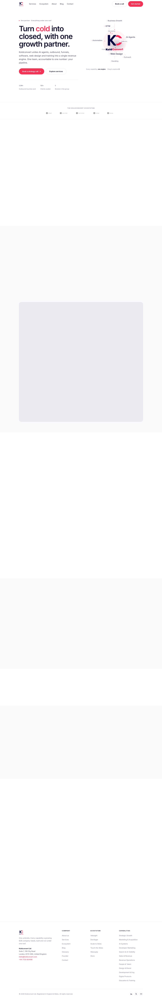


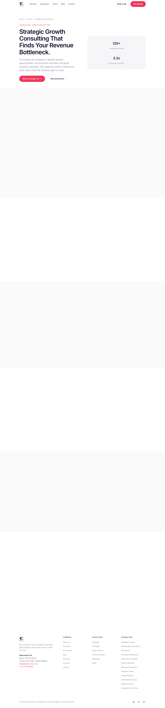

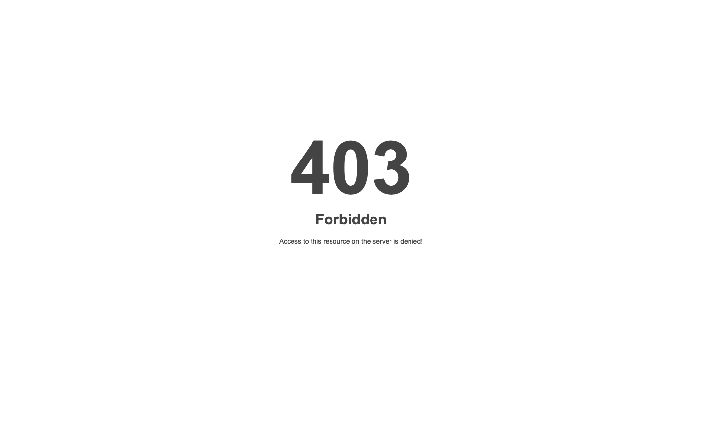

### Section Clips (screens/sections/)

*Clipped individual sections and components*

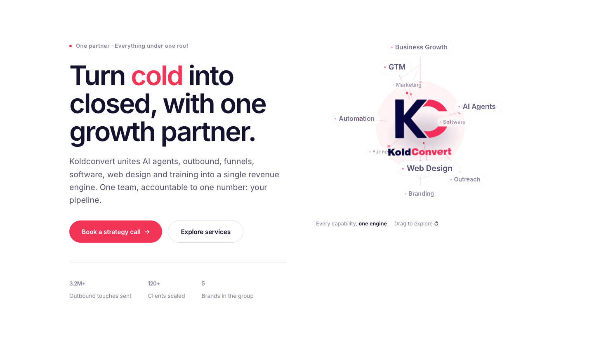

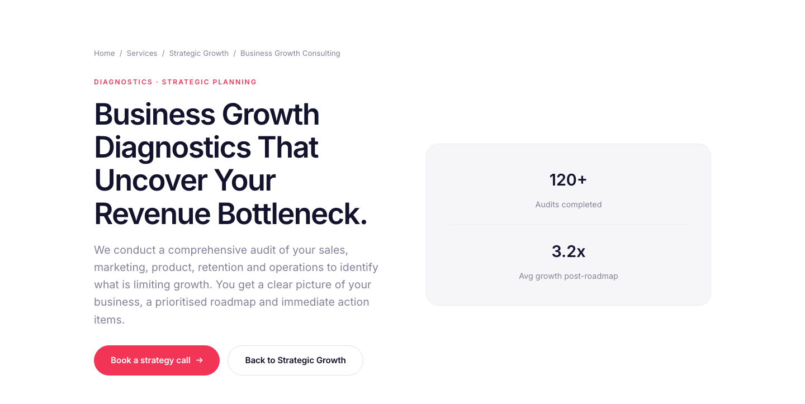


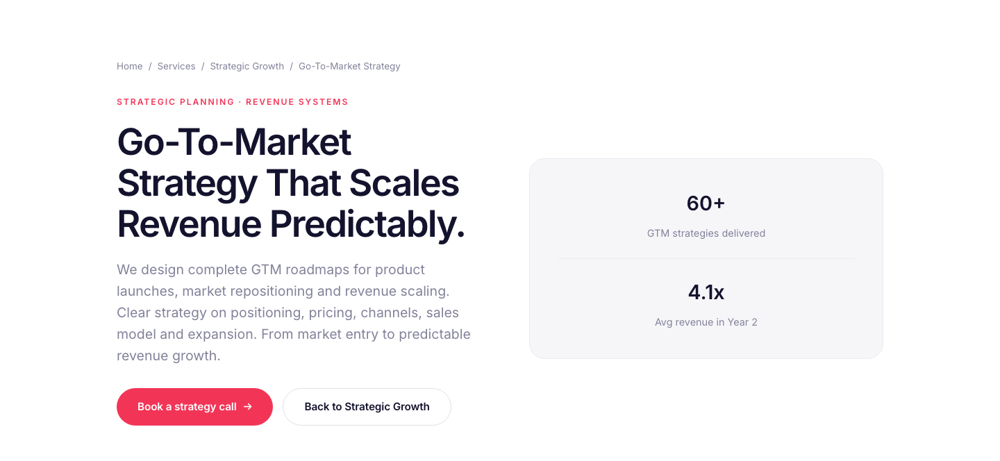


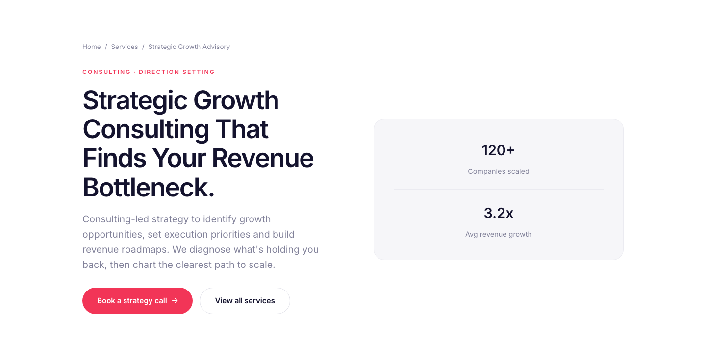

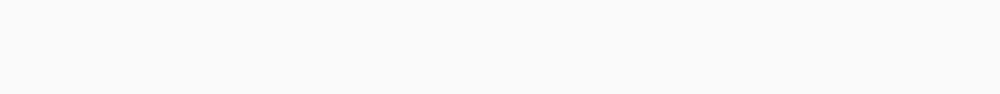

### Interaction States (screens/states/)

*Hover, focus, and active state captures*


### Screenshot Index (screens/INDEX.md)

# Screenshot Index

## Scroll Journey

> Shows the cinematic state at each point of the page

| Scroll | Y Position | File |
|--------|-----------|------|
| 0% | 0px | `screens/scroll/scroll-000.png` |
| 17% | 1357px | `screens/scroll/scroll-017.png` |
| 33% | 2635px | `screens/scroll/scroll-033.png` |
| 50% | 3992px | `screens/scroll/scroll-050.png` |
| 67% | 5349px | `screens/scroll/scroll-067.png` |
| 83% | 6627px | `screens/scroll/scroll-083.png` |
| 100% | 7984px | `screens/scroll/scroll-100.png` |

## Pages

| Page | URL | File |
|------|-----|------|
| Koldconvert | AI, Marketing & Software Agency in London, Everything Under One Roof | `https://koldconvert.com/` | `screens/pages/home.png` |
| 403 Forbidden | `https://koldconvert.com/services` | `screens/pages/services.png` |
| Strategic Growth Advisory | Business Consulting London | Koldconvert | `https://koldconvert.com/services/strategic-growth/` | `screens/pages/services-strategic-growth.png` |
| Business Growth Consulting | Diagnostics & Strategy London | Koldconvert | `https://koldconvert.com/services/strategic-growth/business-growth-consulting` | `screens/pages/services-strategic-growth-business-growth-consulting.png` |
| Go-To-Market Strategy | GTM Planning London | Koldconvert | `https://koldconvert.com/services/strategic-growth/go-to-market-revenue-strategy` | `screens/pages/services-strategic-growth-go-to-market-revenue-strategy.png` |

## Sections

| Page | Section | File |
|------|---------|------|
| home | #1 (section) | `screens/sections/home-section-1.png` |
| services-strategic-growth | #1 (section) | `screens/sections/services-strategic-growth-section-1.png` |
| services-strategic-growth | #2 (section) | `screens/sections/services-strategic-growth-section-2.png` |
| services-strategic-growth-business-growth-consulting | #1 (section) | `screens/sections/services-strategic-growth-business-growth-consulting-section-1.png` |
| services-strategic-growth-business-growth-consulting | #2 (section) | `screens/sections/services-strategic-growth-business-growth-consulting-section-2.png` |
| services-strategic-growth-go-to-market-revenue-strategy | #1 (section) | `screens/sections/services-strategic-growth-go-to-market-revenue-strategy-section-1.png` |
| services-strategic-growth-go-to-market-revenue-strategy | #2 (section) | `screens/sections/services-strategic-growth-go-to-market-revenue-strategy-section-2.png` |

## Homepage Screenshots (screenshots/)


