# maedigital Design System

You are building UI for **maedigital**. Light-themed, warm palette, sans-serif typography (Plus Jakarta Sans), compact density on a 4px grid, expressive motion.

## Visual Reference

**IMPORTANT**: Study ALL screenshots below before writing any UI. Match colors, typography, spacing, layout, and motion exactly as shown.

### Homepage


### Scroll Journey (Cinematic Visual States)

> These screenshots capture the website at different scroll depths. The design changes dramatically as you scroll — each frame shows a different cinematic state. Replicate these exact visual transitions.

#### 0% — Hero / Above the fold


#### 17% — Mid-page at 17% scroll

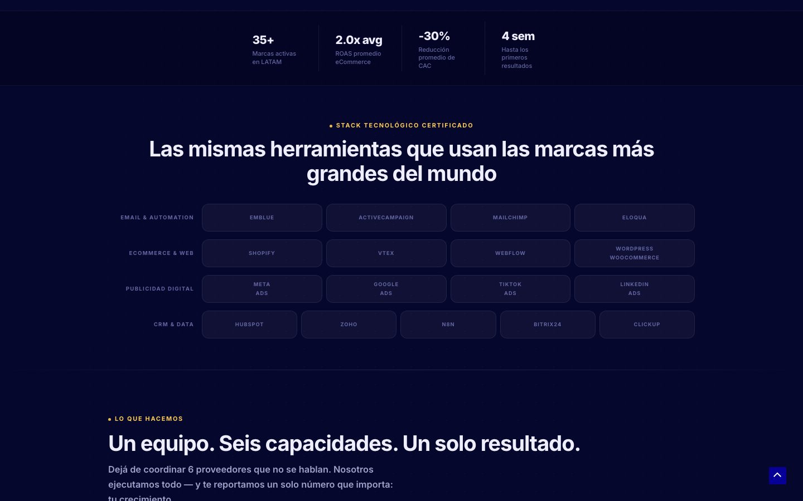

#### 33% — Mid-page at 33% scroll

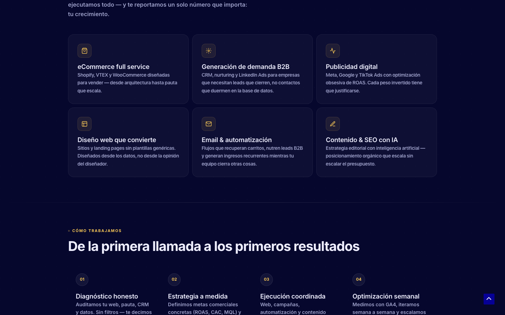

#### 50% — Mid-page at 50% scroll

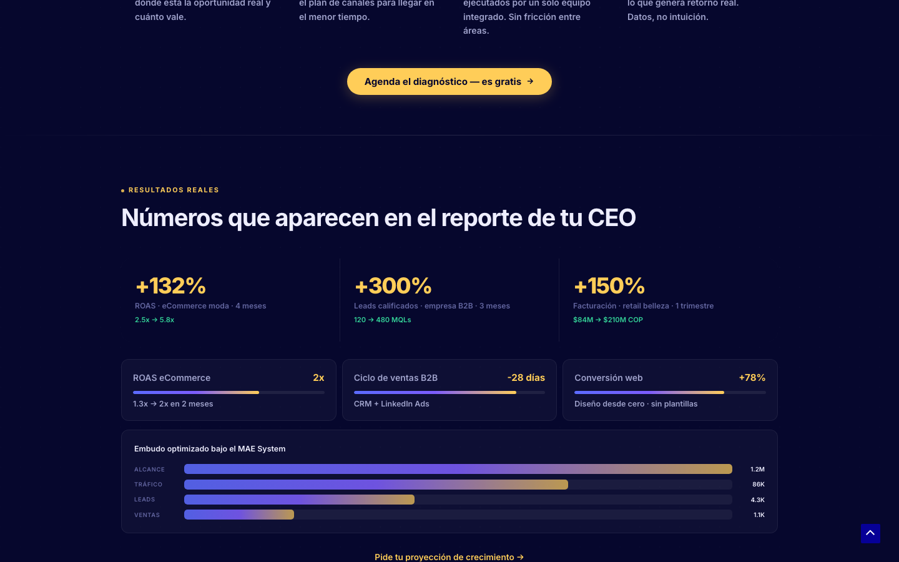

#### 67% — Mid-page at 67% scroll

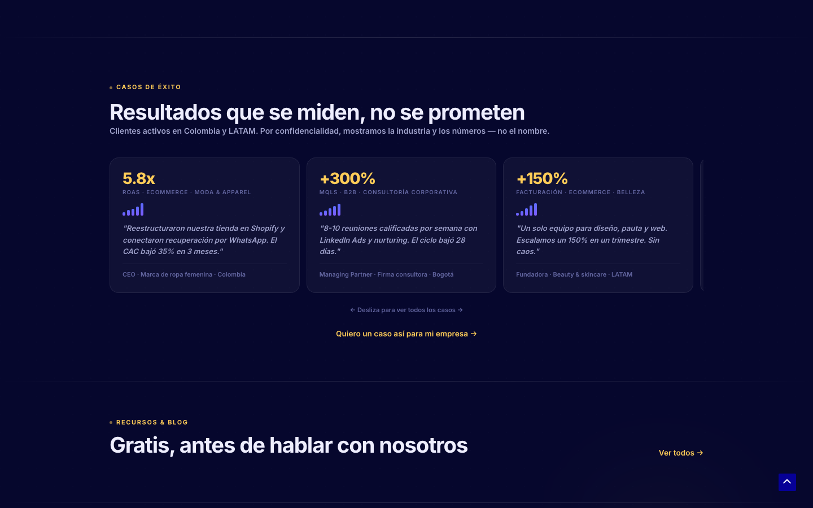

#### 83% — Mid-page at 83% scroll

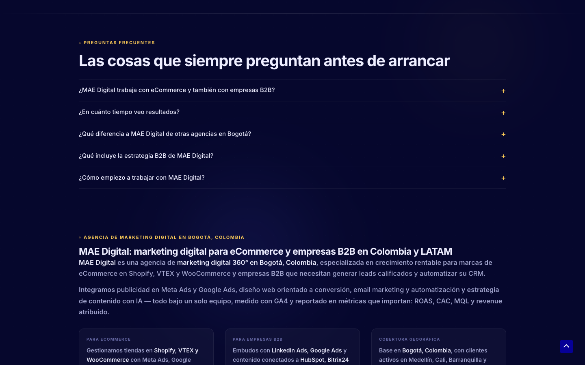

#### 100% — Footer / End of page


> Read `references/DESIGN.md` for full token details. Read `references/ANIMATIONS.md` for motion specs. Read `references/LAYOUT.md` for layout structure. Read `references/COMPONENTS.md` for component patterns.

## Ultra Reference Files

This package includes extended documentation. **Read these files before implementing:**

| File | Contents |
|------|----------|
| `references/DESIGN.md` | Full design system tokens, colors, typography, spacing |
| `references/VISUAL_GUIDE.md` | **START HERE** — Master visual guide with all screenshots embedded |
| `references/ANIMATIONS.md` | CSS keyframes, scroll triggers, motion library stack, video specs |
| `references/LAYOUT.md` | Flex/grid containers, page structure, spacing relationships |
| `references/COMPONENTS.md` | DOM component patterns, HTML structure, class fingerprints |
| `references/INTERACTIONS.md` | Hover/focus states with before/after style diffs |
| `screens/scroll/` | 7 scroll journey screenshots showing cinematic states |

### Animation Stack Detected

- **Web Animations API (7 active)** — animation

## Design Philosophy

- **Layered depth** — use shadow tokens to create a sense of physical layering. Each elevation level has a specific shadow.
- **Gradient accents** — gradients are used thoughtfully for emphasis, not decoration.
- **Type pairing** — Plus Jakarta Sans for body/UI text, Inter for headings/display. Never introduce a third typeface.
- **compact density** — 4px base grid. Every dimension is a multiple of 4.
- **warm palette** — the color temperature runs warm, matching the sans-serif typography.
- **Restrained accent** — `#ffc402` is the only pop of color. Used exclusively for CTAs, links, focus rings, and active states.
- **Expressive motion** — animations are an integral part of the experience. Use spring physics and layout animations.

## Color System

### Core Palette

| Role | Token | Hex | Use |
|------|-------|-----|-----|
| Background | `--background` | `#ffffff` | Page/app background |
| Text Primary | `--text-primary` | `#000000` | Headings, body text |
| Text Muted | `--text-muted` | `#67768e` | Captions, placeholders |
| Accent | `--accent` | `#ffc402` | CTAs, links, focus rings |
| Border | `--border` | `#222222` | Dividers, card borders |

### Status Colors

| Status | Hex | Use |
|--------|-----|-----|
| Success | `#34d399` | Confirmations, positive trends |
| Warning | `#ffcd57` | Caution states, pending items |

### Extended Palette

- **ast-code-block-background:** `#f1f1f1` — Light surface or highlight color
- `#a0a3cc`
- `#8b90c8`
- `#6366a0`
- **ast-global-color-2:** `#1e293b`
- **e-global-color-primary:** `#070835` — Deep background layer or shadow color
- **ast-global-color-0:** `#060097`
- **jkit-txt-m-color:** `#999999`

### CSS Variable Tokens

```css
--jkit-form-border-color: #D5D5D7;
--jkit-success-border-color: rgb(0,127.2,90.8571428571);
--jkit-error-border-color: rgb(214.2,0,0);
--wfp-accent: #71717a;
--wfp-text-secondary-color: hsla(0,0%,100%,.6);
--wfp-text-secondary-color: rgba(0,0,0,.6);
--wp-editor-canvas-background: #ddd;
--wp-admin-border-width-focus: 2px;
--wp-admin-border-width-focus: 1.5px;
--border-radius: 0;
--border-top-width: 0px;
--border-right-width: 0px;
--border-bottom-width: 0px;
--border-left-width: 0px;
--border-style: initial;
--border-color: initial;
--border-block-start-width: var(--border-top-width);
--border-block-end-width: var(--border-bottom-width);
--border-inline-start-width: var(--border-left-width);
--border-inline-end-width: var(--border-right-width);
```

## Typography

### Font Stack

- **Plus Jakarta Sans** — Heading 1, Heading 2, Heading 3
- **Inter** — Body, Caption
- **JetBrains Mono** — Code

### Font Sources

```css
@font-face {
  font-family: "Inter";
  src: url("fonts/Inter-Bold.ttf") format("truetype");
  font-weight: 700;
}
@font-face {
  font-family: "Inter";
  src: url("fonts/Inter-Regular.ttf") format("truetype");
  font-weight: 400;
}
@font-face {
  font-family: "Plus Jakarta Sans";
  src: url("fonts/PlusJakartaSans-Bold.ttf") format("truetype");
  font-weight: 700;
}
@font-face {
  font-family: "Plus Jakarta Sans";
  src: url("fonts/PlusJakartaSans-Regular.ttf") format("truetype");
  font-weight: 400;
}
@font-face {
  font-family: "JetBrains Mono";
  src: url("fonts/JetBrainsMono-Bold.ttf") format("truetype");
  font-weight: 700;
}
@font-face {
  font-family: "JetBrains Mono";
  src: url("fonts/JetBrainsMono-Regular.ttf") format("truetype");
  font-weight: 400;
}
@font-face {
  font-family: "jkiticon";
  src: url("fonts/jkiticon-Regular.woff2") format("woff2");
  font-weight: 400;
}
@font-face {
  font-family: "SF Pro Display";
  src: url("https://maedigital.com.co/wp-content/uploads/2025/02/SF-Pro-Display-Bold.woff2") format("woff2");
  font-weight: 400;
}
@font-face {
  font-family: "SF Pro Display";
  src: url("https://maedigital.com.co/wp-content/uploads/2025/02/SF-Pro-Display-Heavy.woff2") format("woff2");
  font-weight: 700;
}
```

### Type Scale

| Role | Family | Size | Weight |
|------|--------|------|--------|
| Heading 1 | Plus Jakarta Sans | 100px | 700 |
| Heading 2 | Plus Jakarta Sans | 6rem | 700 |
| Heading 3 | Plus Jakarta Sans | 90px | 700 |
| Body | Inter | 15px | 400 |
| Caption | Inter | 14px | 400 |
| Code | JetBrains Mono | 14px | 400 |

### Typography Rules

- Body/UI: **Plus Jakarta Sans**, Headings: **Inter** — these are the only display fonts
- Max 3-4 font sizes per screen
- Headings: weight 600-700, body: weight 400
- Use color and opacity for text hierarchy, not additional font sizes
- Line height: 1.5 for body, 1.2 for headings

## Spacing & Layout

### Base Grid: 4px

Every dimension (margin, padding, gap, width, height) must be a multiple of **4px**.

### Spacing Scale

`2, 4, 6, 8, 10, 12, 14, 16, 18, 20, 22, 24` px

### Spacing as Meaning

| Spacing | Use |
|---------|-----|
| 4-8px | Tight: related items (icon + label, avatar + name) |
| 12-16px | Medium: between groups within a section |
| 24-32px | Wide: between distinct sections |
| 48px+ | Vast: major page section breaks |

### Border Radius

Scale: `.1em, .125rem, 1.5em, 2px, 2em, 3px, 4px, 4.32px, 5px, 6px, 8px, 9px, 10%, 10px, 10px 10px 0px 0px, 12px, 13px, 13.6px, 14px, 15px, 16px, 17.5px, 20px, 30px, 50px, 100%, inherit, 100px`
Default: `10px 10px 0px 0px`

### Container

Max-width: `1180px`, centered with auto margins.

### Breakpoints

| Name | Value |
|------|-------|
| xs | 420px |
| xs | 421px |
| xs | 479px |
| xs | 480px |
| sm | 481px |
| sm | 544px |
| sm | 545px |
| sm | 576px |
| sm | 600px |
| sm | 640px |
| md | 767px |
| md | 768px |
| lg | 769px |
| lg | 781px |
| lg | 782px |
| lg | 900px |
| lg | 921px |
| lg | 921.9px |
| lg | 922px |
| lg | 960px |
| lg | 992px |
| lg | 993px |
| lg | 1024px |
| xl | 1025px |
| xl | 1200px |
| xl | 1201px |
| 2xl | 99999px |

Mobile-first: design for small screens, layer on responsive overrides.

## Component Patterns

### Card

```css
.card {
  background: #ffffff;
  border: 1px solid #222222;
  border-radius: 10px 10px 0px 0px;
  padding: 16px;
  box-shadow: 2.6px 2.6px .4px #ccc,0 0 2.6px #d9d9d9;
}
```

```html
<div class="card">
  <h3>Card Title</h3>
  <p>Card content goes here.</p>
</div>
```

### Button

```css
/* Primary */
.btn-primary {
  background: #ffc402;
  color: #000000;
  border-radius: 10px 10px 0px 0px;
  padding: 8px 16px;
  font-weight: 500;
  transition: opacity 150ms ease;
}
.btn-primary:hover { opacity: 0.9; }

/* Ghost */
.btn-ghost {
  background: transparent;
  border: 1px solid #222222;
  color: #000000;
  border-radius: 10px 10px 0px 0px;
  padding: 8px 16px;
}
```

```html
<button class="btn-primary">Get Started</button>
<button class="btn-ghost">Learn More</button>
```

### Input

```css
.input {
  background: #ffffff;
  border: 1px solid #222222;
  border-radius: 10px 10px 0px 0px;
  padding: 8px 12px;
  color: #000000;
  font-size: 14px;
}
.input:focus { border-color: #ffc402; outline: none; }
```

```html
<input class="input" type="text" placeholder="Search..." />
```

### Badge / Chip

```css
.badge {
  display: inline-flex;
  align-items: center;
  padding: 4px 8px;
  border-radius: 9999px;
  font-size: 12px;
  font-weight: 500;
  background: #ffffff;
  color: #67768e;
}
```

```html
<span class="badge">New</span>
<span class="badge">Beta</span>
```

### Modal / Dialog

```css
.modal-backdrop { background: rgba(0, 0, 0, 0.6); }
.modal {
  background: #ffffff;
  border: 1px solid #222222;
  border-radius: 100px;
  padding: 24px;
  max-width: 480px;
  width: 90vw;
  box-shadow: 0 4px 10px -2px rgba(0,0,0,.1);
}
```

```html
<div class="modal-backdrop">
  <div class="modal">
    <h2>Dialog Title</h2>
    <p>Dialog content.</p>
    <button class="btn-primary">Confirm</button>
    <button class="btn-ghost">Cancel</button>
  </div>
</div>
```

### Table

```css
.table { width: 100%; border-collapse: collapse; }
.table th {
  text-align: left;
  padding: 8px 12px;
  font-weight: 500;
  font-size: 12px;
  color: #67768e;
  text-transform: uppercase;
  letter-spacing: 0.05em;
  border-bottom: 1px solid #222222;
}
.table td {
  padding: 12px;
  border-bottom: 1px solid #222222;
}
```

```html
<table class="table">
  <thead><tr><th>Name</th><th>Status</th><th>Date</th></tr></thead>
  <tbody>
    <tr><td>Item One</td><td>Active</td><td>Jan 1</td></tr>
    <tr><td>Item Two</td><td>Pending</td><td>Jan 2</td></tr>
  </tbody>
</table>
```

### Navigation

```css
.nav {
  display: flex;
  align-items: center;
  gap: 8px;
  padding: 12px 16px;
  border-bottom: 1px solid #222222;
}
.nav-link {
  color: #67768e;
  padding: 8px 12px;
  border-radius: 10px 10px 0px 0px;
  transition: color 150ms;
}
.nav-link:hover { color: #000000; }
.nav-link.active { color: #ffc402; }
```

```html
<nav class="nav">
  <a href="/" class="nav-link active">Home</a>
  <a href="/about" class="nav-link">About</a>
  <a href="/pricing" class="nav-link">Pricing</a>
  <button class="btn-primary" style="margin-left: auto">Get Started</button>
</nav>
```

### Extracted Components

These components were found in the codebase:

**Button** (`html`)

**Card** (`html`)

**Navigation** (`html`)

**Badge** (`html`)

**List** (`html`)

## Page Structure

The following page sections were detected:

- **Navigation** — Top navigation bar (4 items)
- **Hero** — Hero/banner section with headline and CTAs
- **Faq** — FAQ/accordion section
- **Footer** — Page footer with links and info (18 items)
- **Cta** — Call-to-action section
- **Stats** — Statistics/metrics display
- **Testimonials** — Testimonials/reviews section
- **Cards** — Grid of 22 card elements (22 items)
- **Features** — Feature/benefit cards grid (6 items)

When building pages, follow this section order and structure.

## Animation & Motion

This project uses **expressive motion**. Animations are part of the design language.

### CSS Animations

- `fa-spin`
- `slide-from-left`
- `slide-from-right`
- `slide-from-left-reverse`
- `slide-from-right-reverse`

### Motion Tokens

- **Duration scale:** `0ms`, `0s`, `.01ms`, `.3s`, `.4s`, `.75s`, `1.25s`, `2s`, `10ms`, `10s`, `20s`, `100ms`, `120ms`, `150ms`, `200ms`, `250ms`, `300ms`, `350ms`, `400ms`, `500ms`, `600ms`, `700ms`, `800ms`, `1000ms`, `1400ms`, `1500ms`, `1600ms`, `1800ms`, `2200ms`, `5000ms`
- **Easing functions:** `linear`, `ease`, `ease-in-out`, `cubic-bezier(.215,.61,.355,1)`, `ease-out`, `cubic-bezier(.6,.1,.68,.53)`, `cubic-bezier(.9,.03,0,.96)`, `ease-in`

### Motion Guidelines

- **Duration:** Use values from the duration scale above. Short (0ms) for micro-interactions, long (5000ms) for page transitions
- **Easing:** Use `linear` as the default easing curve
- **Direction:** Elements enter from bottom/right, exit to top/left
- **Reduced motion:** Always respect `prefers-reduced-motion` — disable animations when set

## Depth & Elevation

### Shadow Tokens

- Subtle: `0 0 2px 2px rgba(0,0,0,.6)`
- Subtle: `0 0 1px 1px rgba(0,0,0,.2)`
- Subtle: `0 0 2px 2px rgba(0,0,0,.2)`
- Subtle: `inset 0 0 0 1px rgba(0,0,0,.1)`
- Subtle: `0px 1px 2px 0px rgba(0,0,0,0.05)`
- Subtle: `rgba(0, 0, 0, 0.05) 0px 1px 2px 0px`

### Z-Index Scale

`0, 1, 2, 3, 4, 5, 6, 9, 10, 15, 20, 99, 100, 999, 1000, 1001, 1002, 1200, 99999, 100000, 999999, 2000000, 2000001, 2000002, 3000000, 5000000`

Use these exact values — never invent z-index values.

## Anti-Patterns (Never Do)

- **No blur effects** — no backdrop-blur, no filter: blur()
- **No zebra striping** — tables and lists use borders for separation
- **No invented colors** — every hex value must come from the palette above
- **No arbitrary spacing** — every dimension is a multiple of 4px
- **No extra fonts** — only Plus Jakarta Sans and Inter and JetBrains Mono are allowed
- **No arbitrary border-radius** — use the scale: .1em, .125rem, 1.5em, 2px, 2em, 3px, 4px, 4.32px, 5px, 6px
- **No opacity for disabled states** — use muted colors instead

## Workflow

1. **Read** `references/DESIGN.md` before writing any UI code
2. **Pick colors** from the Color System section — never invent new ones
3. **Set typography** — Plus Jakarta Sans, Inter, JetBrains Mono only, using the type scale
4. **Build layout** on the 4px grid — check every margin, padding, gap
5. **Match components** to patterns above before creating new ones
6. **Apply elevation** — use shadow tokens
7. **Validate** — every value traces back to a design token. No magic numbers.

## Brand Spec

- **Favicon:** `https://maedigital.com.co/wp-content/uploads/2025/02/favicon_mae-150x150.png`
- **Site URL:** `https://maedigital.com.co/`
- **Brand color:** `#ffc402`
- **Brand typeface:** Plus Jakarta Sans

## Quick Reference

```
Background:     #ffffff
Surface:        (not extracted)
Text:           #000000 / #67768e
Accent:         #ffc402
Border:         #222222
Font:           Plus Jakarta Sans
Spacing:        4px grid
Radius:         10px 10px 0px 0px
Components:     10 detected
```

## When to Trigger

Activate this skill when:
- Creating new components, pages, or visual elements for maedigital
- Writing CSS, Tailwind classes, styled-components, or inline styles
- Building page layouts, templates, or responsive designs
- Reviewing UI code for design consistency
- The user mentions "maedigital" design, style, UI, or theme
- Generating mockups, wireframes, or visual prototypes

---

# Full Reference Files

> Every output file is embedded below. Claude has full design system context from /skills alone.

## Design System Tokens (DESIGN.md)

# maedigital DESIGN.md

> Auto-generated design system — reverse-engineered via static analysis by skillui.
> Frameworks: None detected
> Colors: 20 · Fonts: 3 · Components: 10
> Icon library: not detected · State: not detected
> Primary theme: light · Dark mode toggle: no · Motion: expressive

## Visual Reference

**Match this design exactly** — study colors, fonts, spacing, and component shapes before writing any UI code.


---

## 1. Visual Theme & Atmosphere

This is a **light-themed** interface with a warm, approachable feel. The light background emphasizes content clarity. Typography pairs **Inter** for display/headings with **Plus Jakarta Sans** for body text, creating clear visual hierarchy through type contrast. Spacing follows a **4px base grid** (compact density), with scale: 2, 4, 6, 8, 10, 12, 14, 16px. The accent color **#ffc402** anchors interactive elements (buttons, links, focus rings). Motion is expressive — spring physics, layout animations, and staggered reveals are part of the visual language.

---

## 2. Color Palette & Roles

| Token | Hex | Role | Use |
|---|---|---|---|
| theme-color | `#ffffff` | background | Page background, darkest surface |
| wfp-button-color | `#000000` | text-primary | Headings and body text |
| ast-global-color-3 | `#67768e` | text-muted | Captions, placeholders, secondary info |
| jkit-txt-h-color | `#222222` | border | Dividers, card borders, outlines |
| wp--preset--color--luminous-vivid-amber | `#ffc402` | accent | CTAs, links, focus rings, active states |
| success | `#34d399` | success | Success states, positive indicators |
| ast-global-color-7 | `#ffcd57` | warning | Warning states, caution indicators |
| info | `#a0a3cc` | info | Informational highlights |
| ast-code-block-background | `#f1f1f1` | unknown | Palette color |
| unknown | `#8b90c8` | unknown | Palette color |
| unknown | `#6366a0` | unknown | Palette color |
| ast-global-color-2 | `#1e293b` | unknown | Palette color |
| e-global-color-primary | `#070835` | unknown | Palette color |
| ast-global-color-0 | `#060097` | unknown | Palette color |
| jkit-txt-m-color | `#999999` | unknown | Palette color |
| unknown | `#565a94` | unknown | Palette color |
| ast-search-border-color | `#e6e6e6` | unknown | Palette color |
| unknown | `#5865f2` | unknown | Palette color |
| unknown | `#444444` | unknown | Palette color |
| unknown | `#cccccc` | unknown | Palette color |

### CSS Variable Tokens

```css
--jkit-form-border-color: #D5D5D7;
--jkit-success-border-color: rgb(0,127.2,90.8571428571);
--jkit-error-border-color: rgb(214.2,0,0);
--wfp-accent: #71717a;
--wfp-text-secondary-color: hsla(0,0%,100%,.6);
--wfp-text-secondary-color: rgba(0,0,0,.6);
--wp-editor-canvas-background: #ddd;
--wp-admin-border-width-focus: 2px;
--wp-admin-border-width-focus: 1.5px;
--border-radius: 0;
--border-top-width: 0px;
--border-right-width: 0px;
--border-bottom-width: 0px;
--border-left-width: 0px;
--border-style: initial;
--border-color: initial;
--border-block-start-width: var(--border-top-width);
--border-block-end-width: var(--border-bottom-width);
--border-inline-start-width: var(--border-left-width);
--border-inline-end-width: var(--border-right-width);
```


---

## 3. Typography Rules

**Font Stack:**
- **Plus Jakarta Sans** — Heading 1, Heading 2, Heading 3
- **Inter** — Body, Caption
- **JetBrains Mono** — Code

**Font Sources:**

```css
@font-face {
  font-family: "Inter";
  src: url("fonts/Inter-Bold.ttf") format("truetype");
  font-weight: 700;
}
@font-face {
  font-family: "Inter";
  src: url("fonts/Inter-Regular.ttf") format("truetype");
  font-weight: 400;
}
@font-face {
  font-family: "Plus Jakarta Sans";
  src: url("fonts/PlusJakartaSans-Bold.ttf") format("truetype");
  font-weight: 700;
}
@font-face {
  font-family: "Plus Jakarta Sans";
  src: url("fonts/PlusJakartaSans-Regular.ttf") format("truetype");
  font-weight: 400;
}
@font-face {
  font-family: "JetBrains Mono";
  src: url("fonts/JetBrainsMono-Bold.ttf") format("truetype");
  font-weight: 700;
}
@font-face {
  font-family: "JetBrains Mono";
  src: url("fonts/JetBrainsMono-Regular.ttf") format("truetype");
  font-weight: 400;
}
@font-face {
  font-family: "jkiticon";
  src: url("fonts/jkiticon-Regular.woff2") format("woff2");
  font-weight: 400;
}
@font-face {
  font-family: "SF Pro Display";
  src: url("https://maedigital.com.co/wp-content/uploads/2025/02/SF-Pro-Display-Bold.woff2") format("woff2");
  font-weight: 400;
}
@font-face {
  font-family: "SF Pro Display";
  src: url("https://maedigital.com.co/wp-content/uploads/2025/02/SF-Pro-Display-Heavy.woff2") format("woff2");
  font-weight: 700;
}
```

| Role | Font | Size | Weight |
|---|---|---|---|
| Heading 1 | Plus Jakarta Sans | 100px | 700 |
| Heading 2 | Plus Jakarta Sans | 6rem | 700 |
| Heading 3 | Plus Jakarta Sans | 90px | 700 |
| Body | Inter | 15px | 400 |
| Caption | Inter | 14px | 400 |
| Code | JetBrains Mono | 14px | 400 |

**Typographic Rules:**
- Limit to 3 font families max per screen
- Use **Plus Jakarta Sans** for body/UI text, **Inter** for display/headings
- Maintain consistent hierarchy: no more than 3-4 font sizes per screen
- Headings use bold (600-700), body uses regular (400)
- Line height: 1.5 for body text, 1.2 for headings
- Use color and opacity for secondary hierarchy, not additional font sizes


---

## 4. Component Stylings

### Layout (1)

**Footer** — `html`

### Navigation (1)

**Navigation** — `html`

### Data Display (3)

**Card** — `html`

**Badge** — `html`

**List** — `html`

### Data Input (2)

**Button** — `html`
- Animation: 

**Input** — `html`
- State: :focus, :placeholder

### Media (3)

**Image** — `html`

**Icon** — `html`

**Map/Canvas** — `html`


---

## 5. Layout Principles

- **Base spacing unit:** 4px
- **Spacing scale:** 2, 4, 6, 8, 10, 12, 14, 16, 18, 20, 22, 24
- **Border radius:** .1em, .125rem, 1.5em, 2px, 2em, 3px, 4px, 4.32px, 5px, 6px, 8px, 9px, 10%, 10px, 10px 10px 0px 0px, 12px, 13px, 13.6px, 14px, 15px, 16px, 17.5px, 20px, 30px, 50px, 100%, inherit, 100px
- **Max content width:** 1180px

**Spacing as Meaning:**
| Spacing | Use |
|---|---|
| 4-8px | Tight: related items within a group |
| 12-16px | Medium: between groups |
| 24-32px | Wide: between sections |
| 48px+ | Vast: major section breaks |


---

## 6. Depth & Elevation

### Flat — subtle depth hints

- `0 0 2px 2px rgba(0,0,0,.6)`
- `0 0 1px 1px rgba(0,0,0,.2)`
- `0 0 2px 2px rgba(0,0,0,.2)`

### Raised — cards, buttons, interactive elements

- `2.6px 2.6px .4px #ccc,0 0 2.6px #d9d9d9`
- `0 0 0 rgba(255,221,0,.37),0 0 0 rgba(255,224,26,.37)`
- `0 2px 4px rgba(0,0,0,.08)`

### Floating — dropdowns, popovers, modals

- `0 4px 10px -2px rgba(0,0,0,.1)`
- `-1.216px 6.894px 15px 0 rgba(37,117,252,.2)`
- `9px 0 0 0 var(--jkit-element-darken-bg-color),18px 0 0 0 var(--jkit-element-darken-bg-color)`

### Overlay — full-screen overlays, top-level dialogs

- `0 0 30px 0 rgba(3,29,60,.05)`
- `0 10px 30px 0 rgba(45,45,45,.2)`
- `0 10px 30px 0 rgba(255,165,0,0)`

### Z-Index Scale

`0, 1, 2, 3, 4, 5, 6, 9, 10, 15, 20, 99, 100, 999, 1000, 1001, 1002, 1200, 99999, 100000, 999999, 2000000, 2000001, 2000002, 3000000, 5000000`


---

## 7. Animation & Motion

This project uses **expressive motion**. Animations are an integral part of the experience.

### CSS Animations

- `@keyframes fa-spin`
- `@keyframes slide-from-left`
- `@keyframes slide-from-right`
- `@keyframes slide-from-left-reverse`
- `@keyframes slide-from-right-reverse`
- `@keyframes jkit-fadeinup`
- `@keyframes jkit-scrolling-vertical`
- `@keyframes jkit-animated-dash`

### Animated Components

- **Button**: 

### Motion Guidelines

- Duration: 150-300ms for micro-interactions, 300-500ms for page transitions
- Easing: `ease-out` for enters, `ease-in` for exits
- Always respect `prefers-reduced-motion`


---

## 8. Do's and Don'ts

### Do's

- Use `#ffc402` for interactive elements (buttons, links, focus rings)
- Use `#ffffff` as the primary page background
- Pair **Plus Jakarta Sans** (body) with **Inter** (display) — these are the only allowed fonts
- Follow the **4px** spacing grid for all margins, padding, and gaps
- Use the defined shadow tokens for elevation — see Section 6
- Use border-radius from the scale: .1em, .125rem, 1.5em, 2px, 2em
- Reuse existing components from Section 4 before creating new ones

### Don'ts

- Don't introduce colors outside this palette — extend the design tokens first
- Don't introduce additional font families beyond Plus Jakarta Sans and Inter and JetBrains Mono
- Don't use arbitrary spacing values — stick to multiples of 4px
- Don't create custom box-shadow values outside the system tokens
- Don't use arbitrary border-radius values — pick from the defined scale
- Don't duplicate component patterns — check Section 4 first
- Don't use backdrop-blur or blur effects

### Anti-Patterns (detected from codebase)

- No blur or backdrop-blur effects
- No zebra striping on tables/lists


---

## 9. Responsive Behavior

| Name | Value | Source |
|---|---|---|
| xs | 420px | css |
| xs | 421px | css |
| xs | 479px | css |
| xs | 480px | css |
| sm | 481px | css |
| sm | 544px | css |
| sm | 545px | css |
| sm | 576px | css |
| sm | 600px | css |
| sm | 640px | css |
| md | 767px | css |
| md | 768px | css |
| lg | 769px | css |
| lg | 781px | css |
| lg | 782px | css |
| lg | 900px | css |
| lg | 921px | css |
| lg | 921.9px | css |
| lg | 922px | css |
| lg | 960px | css |
| lg | 992px | css |
| lg | 993px | css |
| lg | 1024px | css |
| xl | 1025px | css |
| xl | 1200px | css |
| xl | 1201px | css |
| 2xl | 99999px | css |

**Approach:** Use `@media (min-width: ...)` queries matching the breakpoints above.


---

## 10. Agent Prompt Guide

Use these as starting points when building new UI:

### Build a Card

```
Background: #ffffff
Border: 1px solid #222222
Radius: 10px 10px 0px 0px
Padding: 16px
Font: Plus Jakarta Sans
Use shadow tokens from Section 6.
```

### Build a Button

```
Primary: bg #ffc402, text white
Ghost: bg transparent, border #222222
Padding: 8px 16px
Radius: 10px 10px 0px 0px
Hover: opacity 0.9 or lighter shade
Focus: ring with #ffc402
```

### Build a Page Layout

```
Background: #ffffff
Max-width: 1180px, centered
Grid: 4px base
Responsive: mobile-first, breakpoints from Section 9
```

### Build a Stats Card

```
Surface: #ffffff
Label: #67768e (muted, 12px, uppercase)
Value: #000000 (primary, 24-32px, bold)
Status: use success/warning/danger from Section 2
```

### Build a Form

```
Input bg: #ffffff
Input border: 1px solid #222222
Focus: border-color #ffc402
Label: #67768e 12px
Spacing: 16px between fields
Radius: 10px 10px 0px 0px
```

### General Component

```
1. Read DESIGN.md Sections 2-6 for tokens
2. Colors: only from palette
3. Font: Plus Jakarta Sans, type scale from Section 3
4. Spacing: 4px grid
5. Components: match patterns from Section 4
6. Elevation: shadow tokens
```

## Visual Guide — Screenshots (VISUAL_GUIDE.md)

# maedigital — Visual Guide

> Master visual reference. Study every screenshot carefully before implementing any UI.
> Match colors, layout, typography, spacing, and motion states exactly.

**Motion Stack:** **Web Animations API (7 active)**

## Scroll Journey

The page has cinematic scroll animations. Each screenshot below shows the exact visual state at that scroll depth.
**Replicate these transitions precisely** — the design changes dramatically as you scroll.

### Hero — Above the fold

*Scroll position: 0px of 6254px total*


### 17% scroll depth

*Scroll position: 910px of 6254px total*


### 33% scroll depth

*Scroll position: 1767px of 6254px total*


### 50% scroll depth

*Scroll position: 2677px of 6254px total*


### 67% scroll depth

*Scroll position: 3587px of 6254px total*


### 83% scroll depth

*Scroll position: 4444px of 6254px total*


### Footer — End of page

*Scroll position: 5354px of 6254px total*


## Full Page Screenshots

### Inicio - Agencia de Marketing Digital en Colombia | MAE Digital

*URL: `https://maedigital.com.co/`*


### Servicios - MAE Digital | Marketing Digital, eCommerce y Soluciones con I.A

*URL: `https://maedigital.com.co/servicios/`*


### ¿Qué es Marketing Digital? - MAE Digital | Marketing Digital, eCommerce y Soluciones con I.A

*URL: `https://maedigital.com.co/que-es-marketing-digital/`*


### Blog - MAE Digital | Marketing Digital, eCommerce y Soluciones con I.A

*URL: `https://maedigital.com.co/blog/`*


### Contacto - MAE Digital | Marketing Digital, eCommerce y Soluciones con I.A

*URL: `https://maedigital.com.co/contacto/`*


## Section Screenshots

Clipped sections showing individual components in context.

### Section 1 — `section`

*1440×929px*


### Section 1 — `section`

*1440×802px*


### Section 2 — `section`

*1440×756px*


### Section 1 — `article`

*1440×1200px*


### Section 1 — `article`

*1440×1200px*


### Section 1 — `section`

*1440×485px*


### Section 2 — `section`

*1440×975px*


## Animations & Motion (ANIMATIONS.md)

# Animation Reference

> Cinematic motion design extracted from live DOM. Follow these specs exactly to recreate the experience.

## Motion Technology Stack

| Library | Type | Notes |
|---------|------|-------|
| **Web Animations API (7 active)** | animation |  |

## Scroll Journey

The page is **6,254px** tall. Each frame below shows what the user sees at that scroll depth.

> **Use these screenshots to understand WHAT animates, WHEN it animates, and HOW it moves.**

### 0% — Top / Hero
Scroll position: 0px


### 17% — Opening Section
Scroll position: 910px


### 33% — First Feature Section
Scroll position: 1,767px


### 50% — Mid-Page
Scroll position: 2,677px


### 67% — Lower Content
Scroll position: 3,587px


### 83% — Near Footer
Scroll position: 4,444px


### 100% — Bottom / Footer
Scroll position: 5,354px


## Scroll Animation Patterns

| Pattern | Library | Element Count | Duration | Delay | Easing |
|---------|---------|---------------|----------|-------|--------|
| parallax / sticky scroll | CSS | 2 | — | — | — |

### CSS Implementation

## CSS Keyframes (81 extracted)

### `@keyframes blink`

Duration: `2.5s` · Easing: `ease` · Delay: `0s` · Iteration: `infinite` · Fill: `none`

Used by: `.t-ey::before`, `.hero-tag::before`, `.badge-dot`, `.dash-live::before`

```css
@keyframes blink {
  0%, 100% {
    opacity: 1;
  }
  50% {
    opacity: 0.25;
  }
}
```

> Opacity fade

### `@keyframes fa-spin`

Duration: `2s` · Easing: `linear` · Delay: `0s` · Iteration: `infinite` · Fill: `none`

Used by: `.fa-spin`, `.fa-pulse`

```css
@keyframes fa-spin {
  0% {
    transform: rotate(0deg);
  }
  100% {
    transform: rotate(1turn);
  }
}
```

> Transform/motion animation

### `@keyframes fa-spin`

Duration: `2s` · Easing: `linear` · Delay: `0s` · Iteration: `infinite` · Fill: `none`

Used by: `.fa-spin`, `.fa-pulse`

```css
@keyframes fa-spin {
  0% {
    transform: rotate(0deg);
  }
  100% {
    transform: rotate(1turn);
  }
}
```

> Transform/motion animation

### `@keyframes jkit-animated-blinds-in`

Duration: `0.6s` · Easing: `ease` · Delay: `0s` · Iteration: `1` · Fill: `forwards`

Used by: `.jeg-elementor-kit.jkit-animated-text[data-style="rotating"][data-rotate="blinds`, `.jkit-preloader-overlay .jkit-preloader-type .jkit-preloader span`

```css
@keyframes jkit-animated-blinds-in {
  0% {
    transform: rotateY(180deg);
  }
  100% {
    transform: rotateY(0deg);
  }
}
```

> Transform/motion animation

### `@keyframes jkit-animated-blinds-in`

Duration: `0.6s` · Easing: `ease` · Delay: `0s` · Iteration: `1` · Fill: `forwards`

Used by: `.jeg-elementor-kit.jkit-animated-text[data-style="rotating"][data-rotate="blinds`, `.jkit-preloader-overlay .jkit-preloader-type .jkit-preloader span`

```css
@keyframes jkit-animated-blinds-in {
  0% {
    transform: rotateY(180deg);
  }
  100% {
    transform: rotateY(0deg);
  }
}
```

> Transform/motion animation

### `@keyframes eicon-spin`

Duration: `2s` · Easing: `linear` · Delay: `0s` · Iteration: `infinite` · Fill: `none`

Used by: `.elementor-custom-embed-play.elementor-playing i, .elementor-custom-embed-play.e`, `.eicon-animation-spin`

```css
@keyframes eicon-spin {
  0% {
    transform: rotate(0deg);
  }
  100% {
    transform: rotate(359deg);
  }
}
```

> Transform/motion animation

### `@keyframes float`

Duration: `5s` · Easing: `ease-in-out` · Delay: `0s` · Iteration: `infinite` · Fill: `none`

Used by: `.chip1`, `.chip2`

```css
@keyframes float {
  0%, 100% {
    transform: translateY(0px);
  }
  50% {
    transform: translateY(-8px);
  }
}
```

> Transform/motion animation

### `@keyframes slide-from-left`

Duration: `0.5s` · Easing: `ease` · Delay: `0s` · Iteration: `1` · Fill: `forwards`

Used by: `.jeg-elementor-kit:hover .border-bottom.left`

```css
@keyframes slide-from-left {
  0% {
    left: 0px;
  }
  100% {
    left: 101%;
  }
}
```

### `@keyframes slide-from-left`

Duration: `0.5s` · Easing: `ease` · Delay: `0s` · Iteration: `1` · Fill: `forwards`

Used by: `.jeg-elementor-kit:hover .border-bottom.left`

```css
@keyframes slide-from-left {
  0% {
    left: 0px;
  }
  100% {
    left: 101%;
  }
}
```

### `@keyframes slide-from-right`

Duration: `0.5s` · Easing: `ease` · Delay: `0s` · Iteration: `1` · Fill: `forwards`

Used by: `.jeg-elementor-kit:hover .border-bottom.right`

```css
@keyframes slide-from-right {
  0% {
    left: 0px;
  }
  100% {
    left: -101%;
  }
}
```

### `@keyframes slide-from-right`

Duration: `0.5s` · Easing: `ease` · Delay: `0s` · Iteration: `1` · Fill: `forwards`

Used by: `.jeg-elementor-kit:hover .border-bottom.right`

```css
@keyframes slide-from-right {
  0% {
    left: 0px;
  }
  100% {
    left: -101%;
  }
}
```

### `@keyframes slide-from-left-reverse`

Duration: `0.5s` · Easing: `ease` · Delay: `0s` · Iteration: `1` · Fill: `forwards`

Used by: `.jeg-elementor-kit .border-bottom.left`

```css
@keyframes slide-from-left-reverse {
  0% {
    left: -101%;
  }
  100% {
    left: 0px;
  }
}
```

### `@keyframes slide-from-left-reverse`

Duration: `0.5s` · Easing: `ease` · Delay: `0s` · Iteration: `1` · Fill: `forwards`

Used by: `.jeg-elementor-kit .border-bottom.left`

```css
@keyframes slide-from-left-reverse {
  0% {
    left: -101%;
  }
  100% {
    left: 0px;
  }
}
```

### `@keyframes slide-from-right-reverse`

Duration: `0.5s` · Easing: `ease` · Delay: `0s` · Iteration: `1` · Fill: `forwards`

Used by: `.jeg-elementor-kit .border-bottom.right`

```css
@keyframes slide-from-right-reverse {
  0% {
    left: 101%;
  }
  100% {
    left: 0px;
  }
}
```

### `@keyframes slide-from-right-reverse`

Duration: `0.5s` · Easing: `ease` · Delay: `0s` · Iteration: `1` · Fill: `forwards`

Used by: `.jeg-elementor-kit .border-bottom.right`

```css
@keyframes slide-from-right-reverse {
  0% {
    left: 101%;
  }
  100% {
    left: 0px;
  }
}
```

### `@keyframes jkit-fadeinup`

Duration: `0.4s` · Fill: `both`

Used by: `.jeg-elementor-kit.jkit-pagination-disable.loaded .jkit-ajax-loaded, .jeg-elemen`

```css
@keyframes jkit-fadeinup {
  0% {
    opacity: 0;
    transform: translate3d(0px, 30px, 0px);
  }
  100% {
    opacity: 1;
    transform: none;
  }
}
```

> Fade + motion enter animation

### `@keyframes jkit-fadeinup`

Duration: `0.4s` · Fill: `both`

Used by: `.jeg-elementor-kit.jkit-pagination-disable.loaded .jkit-ajax-loaded, .jeg-elemen`

```css
@keyframes jkit-fadeinup {
  0% {
    opacity: 0;
    transform: translate3d(0px, 30px, 0px);
  }
  100% {
    opacity: 1;
    transform: none;
  }
}
```

> Fade + motion enter animation

### `@keyframes jkit-scrolling-vertical`

Duration: `0.3s`

Used by: `.jeg-elementor-kit.jkit-team .social-list .social-icon:hover i::before`

```css
@keyframes jkit-scrolling-vertical {
  0% {
    transform: translateY(0px);
    opacity: 1;
  }
  49% {
    transform: translateY(100%);
    opacity: 0;
  }
  50% {
    transform: translateY(-100%);
    opacity: 0;
  }
  100% {
    transform: translateY(0px);
    opacity: 1;
  }
}
```

> Fade + motion enter animation

### `@keyframes jkit-scrolling-vertical`

Duration: `0.3s`

Used by: `.jeg-elementor-kit.jkit-team .social-list .social-icon:hover i::before`

```css
@keyframes jkit-scrolling-vertical {
  0% {
    transform: translateY(0px);
    opacity: 1;
  }
  49% {
    transform: translateY(100%);
    opacity: 0;
  }
  50% {
    transform: translateY(-100%);
    opacity: 0;
  }
  100% {
    transform: translateY(0px);
    opacity: 1;
  }
}
```

> Fade + motion enter animation

### `@keyframes jkit-animated-dash`

Duration: `10s` · Easing: `ease` · Delay: `0s` · Iteration: `infinite` · Fill: `none`

Used by: `.jeg-elementor-kit.jkit-animated-text .animated-text svg path`

```css
@keyframes jkit-animated-dash {
  0% {
    stroke-dasharray: 0, 1500;
  }
  15% {
    stroke-dasharray: 1500, 1500;
  }
  85% {
    opacity: 1;
  }
  90% {
    stroke-dasharray: 1500, 1500;
    opacity: 0;
  }
  100% {
    stroke-dasharray: 0, 1500;
    opacity: 0;
  }
}
```

> Opacity fade · SVG stroke animation

### `@keyframes jkit-animated-dash`

Duration: `10s` · Easing: `ease` · Delay: `0s` · Iteration: `infinite` · Fill: `none`

Used by: `.jeg-elementor-kit.jkit-animated-text .animated-text svg path`

```css
@keyframes jkit-animated-dash {
  0% {
    stroke-dasharray: 0, 1500;
  }
  15% {
    stroke-dasharray: 1500, 1500;
  }
  85% {
    opacity: 1;
  }
  90% {
    stroke-dasharray: 1500, 1500;
    opacity: 0;
  }
  100% {
    stroke-dasharray: 0, 1500;
    opacity: 0;
  }
}
```

> Opacity fade · SVG stroke animation

### `@keyframes jkit-animated-pulse`

Duration: `1s` · Easing: `ease` · Delay: `0s` · Iteration: `infinite` · Fill: `none`

Used by: `.jeg-elementor-kit.jkit-animated-text[data-style="rotating"][data-rotate="typing`

```css
@keyframes jkit-animated-pulse {
  0% {
    transform: translateY(-50%) scale(1);
    opacity: 1;
  }
  40% {
    transform: translateY(-50%) scale(0.9);
    opacity: 0;
  }
  100% {
    transform: translateY(-50%) scale(0);
    opacity: 0;
  }
}
```

> Fade + motion enter animation

### `@keyframes jkit-animated-pulse`

Duration: `1s` · Easing: `ease` · Delay: `0s` · Iteration: `infinite` · Fill: `none`

Used by: `.jeg-elementor-kit.jkit-animated-text[data-style="rotating"][data-rotate="typing`

```css
@keyframes jkit-animated-pulse {
  0% {
    transform: translateY(-50%) scale(1);
    opacity: 1;
  }
  40% {
    transform: translateY(-50%) scale(0.9);
    opacity: 0;
  }
  100% {
    transform: translateY(-50%) scale(0);
    opacity: 0;
  }
}
```

> Fade + motion enter animation

### `@keyframes jkit-animated-swirl-in`

Duration: `0.4s` · Easing: `ease` · Delay: `0s` · Iteration: `1` · Fill: `forwards`

Used by: `.jeg-elementor-kit.jkit-animated-text[data-style="rotating"][data-rotate="swirl"`

```css
@keyframes jkit-animated-swirl-in {
  0% {
    opacity: 0;
    transform: translateZ(-20px) rotateX(90deg);
  }
  60% {
    opacity: 1;
    transform: translateZ(-20px) rotateX(-10deg);
  }
  100% {
    opacity: 1;
    transform: translateZ(-20px) rotateX(0deg);
  }
}
```

> Fade + motion enter animation

### `@keyframes jkit-animated-swirl-in`

Duration: `0.4s` · Easing: `ease` · Delay: `0s` · Iteration: `1` · Fill: `forwards`

Used by: `.jeg-elementor-kit.jkit-animated-text[data-style="rotating"][data-rotate="swirl"`

```css
@keyframes jkit-animated-swirl-in {
  0% {
    opacity: 0;
    transform: translateZ(-20px) rotateX(90deg);
  }
  60% {
    opacity: 1;
    transform: translateZ(-20px) rotateX(-10deg);
  }
  100% {
    opacity: 1;
    transform: translateZ(-20px) rotateX(0deg);
  }
}
```

> Fade + motion enter animation

### `@keyframes jkit-animated-wave-up`

Duration: `0.3s` · Easing: `ease` · Delay: `0s` · Iteration: `1` · Fill: `forwards`

Used by: `.jeg-elementor-kit.jkit-animated-text[data-style="rotating"][data-rotate="wave"]`

```css
@keyframes jkit-animated-wave-up {
  0% {
    transform: scale(0);
    opacity: 0;
  }
  60% {
    transform: scale(1.2);
    opacity: 1;
  }
  100% {
    transform: scale(1);
    opacity: 1;
  }
}
```

> Fade + motion enter animation

### `@keyframes jkit-animated-wave-up`

Duration: `0.3s` · Easing: `ease` · Delay: `0s` · Iteration: `1` · Fill: `forwards`

Used by: `.jeg-elementor-kit.jkit-animated-text[data-style="rotating"][data-rotate="wave"]`

```css
@keyframes jkit-animated-wave-up {
  0% {
    transform: scale(0);
    opacity: 0;
  }
  60% {
    transform: scale(1.2);
    opacity: 1;
  }
  100% {
    transform: scale(1);
    opacity: 1;
  }
}
```

> Fade + motion enter animation

### `@keyframes jkit-animated-flip-in`

Duration: `1.2s` · Easing: `ease` · Delay: `0s` · Iteration: `1` · Fill: `none`

Used by: `.jeg-elementor-kit.jkit-animated-text[data-style="rotating"][data-rotate="flip"]`

```css
@keyframes jkit-animated-flip-in {
  0% {
    transform: rotateX(180deg);
    opacity: 0;
  }
  35% {
    transform: rotateX(120deg);
    opacity: 0;
  }
  65% {
    opacity: 0;
  }
  100% {
    transform: rotateX(360deg);
    opacity: 1;
  }
}
```

> Fade + motion enter animation

### `@keyframes jkit-animated-flip-in`

Duration: `1.2s` · Easing: `ease` · Delay: `0s` · Iteration: `1` · Fill: `none`

Used by: `.jeg-elementor-kit.jkit-animated-text[data-style="rotating"][data-rotate="flip"]`

```css
@keyframes jkit-animated-flip-in {
  0% {
    transform: rotateX(180deg);
    opacity: 0;
  }
  35% {
    transform: rotateX(120deg);
    opacity: 0;
  }
  65% {
    opacity: 0;
  }
  100% {
    transform: rotateX(360deg);
    opacity: 1;
  }
}
```

> Fade + motion enter animation

### `@keyframes jkit-animated-flip-out`

Duration: `1.2s` · Easing: `ease` · Delay: `0s` · Iteration: `1` · Fill: `none`

Used by: `.jeg-elementor-kit.jkit-animated-text[data-style="rotating"][data-rotate="flip"]`

```css
@keyframes jkit-animated-flip-out {
  0% {
    transform: rotateX(0deg);
    opacity: 1;
  }
  35% {
    transform: rotateX(-40deg);
    opacity: 0;
  }
  65% {
    opacity: 0;
  }
  100% {
    transform: rotateX(180deg);
    opacity: 0;
  }
}
```

> Fade + motion enter animation

### `@keyframes jkit-animated-flip-out`

Duration: `1.2s` · Easing: `ease` · Delay: `0s` · Iteration: `1` · Fill: `none`

Used by: `.jeg-elementor-kit.jkit-animated-text[data-style="rotating"][data-rotate="flip"]`

```css
@keyframes jkit-animated-flip-out {
  0% {
    transform: rotateX(0deg);
    opacity: 1;
  }
  35% {
    transform: rotateX(-40deg);
    opacity: 0;
  }
  65% {
    opacity: 0;
  }
  100% {
    transform: rotateX(180deg);
    opacity: 0;
  }
}
```

> Fade + motion enter animation

### `@keyframes jkit-animated-drop-in-in`

Duration: `0.6s` · Easing: `ease` · Delay: `0s` · Iteration: `1` · Fill: `none`

Used by: `.jeg-elementor-kit.jkit-animated-text[data-style="rotating"][data-rotate="drop-i`

```css
@keyframes jkit-animated-drop-in-in {
  0% {
    opacity: 0;
    transform: translateZ(100px);
  }
  100% {
    opacity: 1;
    transform: translateZ(0px);
  }
}
```

> Fade + motion enter animation

### `@keyframes jkit-animated-drop-in-in`

Duration: `0.6s` · Easing: `ease` · Delay: `0s` · Iteration: `1` · Fill: `none`

Used by: `.jeg-elementor-kit.jkit-animated-text[data-style="rotating"][data-rotate="drop-i`

```css
@keyframes jkit-animated-drop-in-in {
  0% {
    opacity: 0;
    transform: translateZ(100px);
  }
  100% {
    opacity: 1;
    transform: translateZ(0px);
  }
}
```

> Fade + motion enter animation

### `@keyframes jkit-animated-drop-in-out`

Duration: `0.6s` · Easing: `ease` · Delay: `0s` · Iteration: `1` · Fill: `none`

Used by: `.jeg-elementor-kit.jkit-animated-text[data-style="rotating"][data-rotate="drop-i`

```css
@keyframes jkit-animated-drop-in-out {
  0% {
    opacity: 1;
    transform: translateZ(0px);
  }
  100% {
    opacity: 0;
    transform: translateZ(-100px);
  }
}
```

> Fade + motion enter animation

### `@keyframes jkit-animated-drop-in-out`

Duration: `0.6s` · Easing: `ease` · Delay: `0s` · Iteration: `1` · Fill: `none`

Used by: `.jeg-elementor-kit.jkit-animated-text[data-style="rotating"][data-rotate="drop-i`

```css
@keyframes jkit-animated-drop-in-out {
  0% {
    opacity: 1;
    transform: translateZ(0px);
  }
  100% {
    opacity: 0;
    transform: translateZ(-100px);
  }
}
```

> Fade + motion enter animation

### `@keyframes jkit-animated-slide-right-in`

Duration: `0.6s` · Easing: `ease` · Delay: `0s` · Iteration: `1` · Fill: `none`

Used by: `.jeg-elementor-kit.jkit-animated-text[data-style="rotating"][data-rotate="slide-`

```css
@keyframes jkit-animated-slide-right-in {
  0% {
    opacity: 0;
    transform: translateX(-100%);
  }
  60% {
    opacity: 1;
    transform: translateX(10%);
  }
  100% {
    opacity: 1;
    transform: translateX(0px);
  }
}
```

> Fade + motion enter animation

### `@keyframes jkit-animated-slide-right-in`

Duration: `0.6s` · Easing: `ease` · Delay: `0s` · Iteration: `1` · Fill: `none`

Used by: `.jeg-elementor-kit.jkit-animated-text[data-style="rotating"][data-rotate="slide-`

```css
@keyframes jkit-animated-slide-right-in {
  0% {
    opacity: 0;
    transform: translateX(-100%);
  }
  60% {
    opacity: 1;
    transform: translateX(10%);
  }
  100% {
    opacity: 1;
    transform: translateX(0px);
  }
}
```

> Fade + motion enter animation

### `@keyframes jkit-animated-slide-right-out`

Duration: `0.6s` · Easing: `ease` · Delay: `0s` · Iteration: `1` · Fill: `none`

Used by: `.jeg-elementor-kit.jkit-animated-text[data-style="rotating"][data-rotate="slide-`

```css
@keyframes jkit-animated-slide-right-out {
  0% {
    opacity: 1;
    transform: translateX(0px);
  }
  60% {
    opacity: 0;
    transform: translateX(110%);
  }
  100% {
    opacity: 0;
    transform: translateX(100%);
  }
}
```

> Fade + motion enter animation

### `@keyframes jkit-animated-slide-right-out`

Duration: `0.6s` · Easing: `ease` · Delay: `0s` · Iteration: `1` · Fill: `none`

Used by: `.jeg-elementor-kit.jkit-animated-text[data-style="rotating"][data-rotate="slide-`

```css
@keyframes jkit-animated-slide-right-out {
  0% {
    opacity: 1;
    transform: translateX(0px);
  }
  60% {
    opacity: 0;
    transform: translateX(110%);
  }
  100% {
    opacity: 0;
    transform: translateX(100%);
  }
}
```

> Fade + motion enter animation

### `@keyframes jkit-animated-slide-left-in`

Duration: `0.6s` · Easing: `ease` · Delay: `0s` · Iteration: `1` · Fill: `none`

Used by: `.jeg-elementor-kit.jkit-animated-text[data-style="rotating"][data-rotate="slide-`

```css
@keyframes jkit-animated-slide-left-in {
  0% {
    opacity: 0;
    transform: translateX(100%);
  }
  60% {
    opacity: 1;
    transform: translateX(-10%);
  }
  100% {
    opacity: 1;
    transform: translateX(0px);
  }
}
```

> Fade + motion enter animation

### `@keyframes jkit-animated-slide-left-in`

Duration: `0.6s` · Easing: `ease` · Delay: `0s` · Iteration: `1` · Fill: `none`

Used by: `.jeg-elementor-kit.jkit-animated-text[data-style="rotating"][data-rotate="slide-`

```css
@keyframes jkit-animated-slide-left-in {
  0% {
    opacity: 0;
    transform: translateX(100%);
  }
  60% {
    opacity: 1;
    transform: translateX(-10%);
  }
  100% {
    opacity: 1;
    transform: translateX(0px);
  }
}
```

> Fade + motion enter animation

### `@keyframes jkit-animated-slide-left-out`

Duration: `0.6s` · Easing: `ease` · Delay: `0s` · Iteration: `1` · Fill: `none`

Used by: `.jeg-elementor-kit.jkit-animated-text[data-style="rotating"][data-rotate="slide-`

```css
@keyframes jkit-animated-slide-left-out {
  0% {
    opacity: 1;
    transform: translateX(0px);
  }
  60% {
    opacity: 0;
    transform: translateX(-110%);
  }
  100% {
    opacity: 0;
    transform: translateX(-100%);
  }
}
```

> Fade + motion enter animation

### `@keyframes jkit-animated-slide-left-out`

Duration: `0.6s` · Easing: `ease` · Delay: `0s` · Iteration: `1` · Fill: `none`

Used by: `.jeg-elementor-kit.jkit-animated-text[data-style="rotating"][data-rotate="slide-`

```css
@keyframes jkit-animated-slide-left-out {
  0% {
    opacity: 1;
    transform: translateX(0px);
  }
  60% {
    opacity: 0;
    transform: translateX(-110%);
  }
  100% {
    opacity: 0;
    transform: translateX(-100%);
  }
}
```

> Fade + motion enter animation

### `@keyframes jkit-animated-slide-up-in`

Duration: `0.6s` · Easing: `ease` · Delay: `0s` · Iteration: `1` · Fill: `none`

Used by: `.jeg-elementor-kit.jkit-animated-text[data-style="rotating"][data-rotate="slide-`

```css
@keyframes jkit-animated-slide-up-in {
  0% {
    opacity: 0;
    transform: translateY(100%);
  }
  60% {
    opacity: 1;
    transform: translateY(-20%);
  }
  100% {
    opacity: 1;
    transform: translateY(0px);
  }
}
```

> Fade + motion enter animation

### `@keyframes jkit-animated-slide-up-in`

Duration: `0.6s` · Easing: `ease` · Delay: `0s` · Iteration: `1` · Fill: `none`

Used by: `.jeg-elementor-kit.jkit-animated-text[data-style="rotating"][data-rotate="slide-`

```css
@keyframes jkit-animated-slide-up-in {
  0% {
    opacity: 0;
    transform: translateY(100%);
  }
  60% {
    opacity: 1;
    transform: translateY(-20%);
  }
  100% {
    opacity: 1;
    transform: translateY(0px);
  }
}
```

> Fade + motion enter animation

### `@keyframes jkit-animated-slide-up-out`

Duration: `0.6s` · Easing: `ease` · Delay: `0s` · Iteration: `1` · Fill: `none`

Used by: `.jeg-elementor-kit.jkit-animated-text[data-style="rotating"][data-rotate="slide-`

```css
@keyframes jkit-animated-slide-up-out {
  0% {
    opacity: 1;
    transform: translateY(0px);
  }
  60% {
    opacity: 0;
    transform: translateY(-120%);
  }
  100% {
    opacity: 0;
    transform: translateY(-100%);
  }
}
```

> Fade + motion enter animation

### `@keyframes jkit-animated-slide-up-out`

Duration: `0.6s` · Easing: `ease` · Delay: `0s` · Iteration: `1` · Fill: `none`

Used by: `.jeg-elementor-kit.jkit-animated-text[data-style="rotating"][data-rotate="slide-`

```css
@keyframes jkit-animated-slide-up-out {
  0% {
    opacity: 1;
    transform: translateY(0px);
  }
  60% {
    opacity: 0;
    transform: translateY(-120%);
  }
  100% {
    opacity: 0;
    transform: translateY(-100%);
  }
}
```

> Fade + motion enter animation

### `@keyframes jkit-animated-slide-down-in`

Duration: `0.6s` · Easing: `ease` · Delay: `0s` · Iteration: `1` · Fill: `none`

Used by: `.jeg-elementor-kit.jkit-animated-text[data-style="rotating"][data-rotate="slide-`

```css
@keyframes jkit-animated-slide-down-in {
  0% {
    opacity: 0;
    transform: translateY(-100%);
  }
  60% {
    opacity: 1;
    transform: translateY(20%);
  }
  100% {
    opacity: 1;
    transform: translateY(0px);
  }
}
```

> Fade + motion enter animation

### `@keyframes jkit-animated-slide-down-in`

Duration: `0.6s` · Easing: `ease` · Delay: `0s` · Iteration: `1` · Fill: `none`

Used by: `.jeg-elementor-kit.jkit-animated-text[data-style="rotating"][data-rotate="slide-`

```css
@keyframes jkit-animated-slide-down-in {
  0% {
    opacity: 0;
    transform: translateY(-100%);
  }
  60% {
    opacity: 1;
    transform: translateY(20%);
  }
  100% {
    opacity: 1;
    transform: translateY(0px);
  }
}
```

> Fade + motion enter animation

### `@keyframes jkit-animated-slide-down-out`

Duration: `0.6s` · Easing: `ease` · Delay: `0s` · Iteration: `1` · Fill: `none`

Used by: `.jeg-elementor-kit.jkit-animated-text[data-style="rotating"][data-rotate="slide-`

```css
@keyframes jkit-animated-slide-down-out {
  0% {
    opacity: 1;
    transform: translateY(0px);
  }
  60% {
    opacity: 0;
    transform: translateY(120%);
  }
  100% {
    opacity: 0;
    transform: translateY(100%);
  }
}
```

> Fade + motion enter animation

### `@keyframes jkit-animated-slide-down-out`

Duration: `0.6s` · Easing: `ease` · Delay: `0s` · Iteration: `1` · Fill: `none`

Used by: `.jeg-elementor-kit.jkit-animated-text[data-style="rotating"][data-rotate="slide-`

```css
@keyframes jkit-animated-slide-down-out {
  0% {
    opacity: 1;
    transform: translateY(0px);
  }
  60% {
    opacity: 0;
    transform: translateY(120%);
  }
  100% {
    opacity: 0;
    transform: translateY(100%);
  }
}
```

> Fade + motion enter animation

### `@keyframes jkit-animated-bounce-in`

Duration: `0.6s` · Easing: `ease` · Delay: `0s` · Iteration: `1` · Fill: `none`

Used by: `.jeg-elementor-kit.jkit-animated-text[data-style="rotating"][data-rotate="bounce`

```css
@keyframes jkit-animated-bounce-in {
  0%, 20%, 40%, 60%, 80%, 100% {
    animation-timing-function: cubic-bezier(0.215, 0.61, 0.355, 1);
  }
  0% {
    opacity: 0;
    transform: scale3d(0.3, 0.3, 0.3);
  }
  20% {
    transform: scale3d(1.1, 1.1, 1.1);
  }
  40% {
    transform: scale3d(0.9, 0.9, 0.9);
  }
  60% {
    opacity: 1;
    transform: scale3d(1.03, 1.03, 1.03);
  }
  80% {
    transform: scale3d(0.97, 0.97, 0.97);
  }
  100% {
    opacity: 1;
    transform: scaleX(1);
  }
}
```

> Fade + motion enter animation

### `@keyframes jkit-animated-bounce-in`

Duration: `0.6s` · Easing: `ease` · Delay: `0s` · Iteration: `1` · Fill: `none`

Used by: `.jeg-elementor-kit.jkit-animated-text[data-style="rotating"][data-rotate="bounce`

```css
@keyframes jkit-animated-bounce-in {
  0%, 20%, 40%, 60%, 80%, 100% {
    animation-timing-function: cubic-bezier(0.215, 0.61, 0.355, 1);
  }
  0% {
    opacity: 0;
    transform: scale3d(0.3, 0.3, 0.3);
  }
  20% {
    transform: scale3d(1.1, 1.1, 1.1);
  }
  40% {
    transform: scale3d(0.9, 0.9, 0.9);
  }
  60% {
    opacity: 1;
    transform: scale3d(1.03, 1.03, 1.03);
  }
  80% {
    transform: scale3d(0.97, 0.97, 0.97);
  }
  100% {
    opacity: 1;
    transform: scaleX(1);
  }
}
```

> Fade + motion enter animation

### `@keyframes jkit-animated-bounce-out`

Duration: `0.6s` · Easing: `ease` · Delay: `0s` · Iteration: `1` · Fill: `none`

Used by: `.jeg-elementor-kit.jkit-animated-text[data-style="rotating"][data-rotate="bounce`

```css
@keyframes jkit-animated-bounce-out {
  20% {
    transform: scale3d(0.9, 0.9, 0.9);
  }
  50%, 55% {
    opacity: 0;
    transform: scale3d(1.1, 1.1, 1.1);
  }
  100% {
    opacity: 0;
    transform: scale3d(0.3, 0.3, 0.3);
  }
}
```

> Fade + motion enter animation

### `@keyframes jkit-animated-bounce-out`

Duration: `0.6s` · Easing: `ease` · Delay: `0s` · Iteration: `1` · Fill: `none`

Used by: `.jeg-elementor-kit.jkit-animated-text[data-style="rotating"][data-rotate="bounce`

```css
@keyframes jkit-animated-bounce-out {
  20% {
    transform: scale3d(0.9, 0.9, 0.9);
  }
  50%, 55% {
    opacity: 0;
    transform: scale3d(1.1, 1.1, 1.1);
  }
  100% {
    opacity: 0;
    transform: scale3d(0.3, 0.3, 0.3);
  }
}
```

> Fade + motion enter animation

### `@keyframes jkit-animated-swing-in`

Duration: `0.6s` · Easing: `ease` · Delay: `0s` · Iteration: `1` · Fill: `none`

Used by: `.jeg-elementor-kit.jkit-animated-text[data-style="rotating"][data-rotate="swing"`

```css
@keyframes jkit-animated-swing-in {
  20% {
    transform: rotate(15deg);
  }
  40% {
    transform: rotate(-10deg);
  }
  60% {
    transform: rotate(5deg);
  }
  80% {
    transform: rotate(-5deg);
  }
  100% {
    transform: rotate(0deg);
  }
}
```

> Transform/motion animation

### `@keyframes jkit-animated-swing-in`

Duration: `0.6s` · Easing: `ease` · Delay: `0s` · Iteration: `1` · Fill: `none`

Used by: `.jeg-elementor-kit.jkit-animated-text[data-style="rotating"][data-rotate="swing"`

```css
@keyframes jkit-animated-swing-in {
  20% {
    transform: rotate(15deg);
  }
  40% {
    transform: rotate(-10deg);
  }
  60% {
    transform: rotate(5deg);
  }
  80% {
    transform: rotate(-5deg);
  }
  100% {
    transform: rotate(0deg);
  }
}
```

> Transform/motion animation

### `@keyframes jkit-animated-swing-out`

Duration: `0.6s` · Easing: `ease` · Delay: `0s` · Iteration: `1` · Fill: `none`

Used by: `.jeg-elementor-kit.jkit-animated-text[data-style="rotating"][data-rotate="swing"`

```css
@keyframes jkit-animated-swing-out {
  20% {
    transform: rotate(0deg);
  }
  40% {
    transform: rotate(-5deg);
  }
  60% {
    transform: rotate(10deg);
  }
  80% {
    transform: rotate(-15deg);
  }
  100% {
    transform: rotate(15deg);
  }
}
```

> Transform/motion animation

### `@keyframes jkit-animated-swing-out`

Duration: `0.6s` · Easing: `ease` · Delay: `0s` · Iteration: `1` · Fill: `none`

Used by: `.jeg-elementor-kit.jkit-animated-text[data-style="rotating"][data-rotate="swing"`

```css
@keyframes jkit-animated-swing-out {
  20% {
    transform: rotate(0deg);
  }
  40% {
    transform: rotate(-5deg);
  }
  60% {
    transform: rotate(10deg);
  }
  80% {
    transform: rotate(-15deg);
  }
  100% {
    transform: rotate(15deg);
  }
}
```

> Transform/motion animation

### `@keyframes jkit-animated-rubber-band-in`

Duration: `0.6s` · Easing: `ease` · Delay: `0s` · Iteration: `1` · Fill: `none`

Used by: `.jeg-elementor-kit.jkit-animated-text[data-style="rotating"][data-rotate="rubber`

```css
@keyframes jkit-animated-rubber-band-in {
  0% {
    transform: scaleX(1);
  }
  30% {
    transform: scale3d(1.25, 0.75, 1);
  }
  40% {
    transform: scale3d(0.75, 1.25, 1);
  }
  50% {
    transform: scale3d(1.15, 0.85, 1);
  }
  65% {
    transform: scale3d(0.95, 1.05, 1);
  }
  75% {
    transform: scale3d(1.05, 0.95, 1);
  }
  100% {
    transform: scaleX(1);
  }
}
```

> Transform/motion animation

### `@keyframes jkit-animated-rubber-band-in`

Duration: `0.6s` · Easing: `ease` · Delay: `0s` · Iteration: `1` · Fill: `none`

Used by: `.jeg-elementor-kit.jkit-animated-text[data-style="rotating"][data-rotate="rubber`

```css
@keyframes jkit-animated-rubber-band-in {
  0% {
    transform: scaleX(1);
  }
  30% {
    transform: scale3d(1.25, 0.75, 1);
  }
  40% {
    transform: scale3d(0.75, 1.25, 1);
  }
  50% {
    transform: scale3d(1.15, 0.85, 1);
  }
  65% {
    transform: scale3d(0.95, 1.05, 1);
  }
  75% {
    transform: scale3d(1.05, 0.95, 1);
  }
  100% {
    transform: scaleX(1);
  }
}
```

> Transform/motion animation

### `@keyframes jkit-animated-rubber-band-out`

Duration: `0.6s` · Easing: `ease` · Delay: `0s` · Iteration: `1` · Fill: `none`

Used by: `.jeg-elementor-kit.jkit-animated-text[data-style="rotating"][data-rotate="rubber`

```css
@keyframes jkit-animated-rubber-band-out {
  0% {
    transform: scaleX(1);
  }
  30% {
    transform: scale3d(1.05, 0.95, 1);
  }
  40% {
    transform: scale3d(0.95, 1.05, 1);
  }
  50% {
    transform: scale3d(1.15, 0.85, 1);
  }
  65% {
    transform: scale3d(0.75, 1.25, 1);
  }
  75% {
    transform: scale3d(1.25, 0.75, 1);
  }
  100% {
    transform: scaleX(1);
  }
}
```

> Transform/motion animation

### `@keyframes jkit-animated-rubber-band-out`

Duration: `0.6s` · Easing: `ease` · Delay: `0s` · Iteration: `1` · Fill: `none`

Used by: `.jeg-elementor-kit.jkit-animated-text[data-style="rotating"][data-rotate="rubber`

```css
@keyframes jkit-animated-rubber-band-out {
  0% {
    transform: scaleX(1);
  }
  30% {
    transform: scale3d(1.05, 0.95, 1);
  }
  40% {
    transform: scale3d(0.95, 1.05, 1);
  }
  50% {
    transform: scale3d(1.15, 0.85, 1);
  }
  65% {
    transform: scale3d(0.75, 1.25, 1);
  }
  75% {
    transform: scale3d(1.25, 0.75, 1);
  }
  100% {
    transform: scaleX(1);
  }
}
```

> Transform/motion animation

### `@keyframes jkit-ripple`

Duration: `3s` · Easing: `ease` · Delay: `0s` · Iteration: `infinite` · Fill: `none`

Used by: `.jeg-elementor-kit.jkit-video-button .jkit-video-popup-btn.glow-enable.hover-gra`

```css
@keyframes jkit-ripple {
  70% {
    box-shadow: currentcolor 0px 0px 0px 15px;
    opacity: 0;
  }
  100% {
    box-shadow: currentcolor 0px 0px 0px 0px;
    opacity: 0;
  }
}
```

> Opacity fade · Shadow pulse/glow effect

### `@keyframes jkit-ripple`

Duration: `3s` · Easing: `ease` · Delay: `0s` · Iteration: `infinite` · Fill: `none`

Used by: `.jeg-elementor-kit.jkit-video-button .jkit-video-popup-btn.glow-enable.hover-gra`

```css
@keyframes jkit-ripple {
  70% {
    box-shadow: currentcolor 0px 0px 0px 15px;
    opacity: 0;
  }
  100% {
    box-shadow: currentcolor 0px 0px 0px 0px;
    opacity: 0;
  }
}
```

> Opacity fade · Shadow pulse/glow effect

### `@keyframes jkit-search-background`

Duration: `0.8s` · Easing: `ease-out` · Delay: `0s` · Iteration: `1` · Fill: `forwards`

Used by: `.jeg-elementor-kit.jkit-search .swal2-container::before`

```css
@keyframes jkit-search-background {
  0% {
    opacity: 0;
    transform: scale(0.04) translateY(300%);
  }
  40% {
    transform: scale(0.04) translateY(0px);
    transition-behavior: normal;
    transition-duration: 0s;
    transition-timing-function: ease-out;
    transition-delay: 0s;
    transition-property: all;
  }
  40% {
    transform: scale(0.04) translateY(0px);
  }
  60% {
    opacity: 1;
    transform: scale(0.02) translateY(0px);
  }
  61% {
    opacity: 1;
    transform: scale(0.04) translateY(0px);
  }
  99.9% {
    opacity: 1;
    height: 0px;
    padding-bottom: 100%;
    border-top-left-radius: 100%;
    border-top-right-radius: 100%;
    border-bottom-right-radius: 100%;
    border-bottom-left-radius: 100%;
  }
  100% {
    opacity: 1;
    transform: scale(2) translateY(0px);
    height: 100%;
    padding-bottom: 0px;
    border-top-left-radius: 0px;
    border-top-right-radius: 0px;
    border-bottom-right-radius: 0px;
    border-bottom-left-radius: 0px;
  }
}
```

> Fade + motion enter animation · Dimension expand/collapse

### `@keyframes jkit-search-background`

Duration: `0.8s` · Easing: `ease-out` · Delay: `0s` · Iteration: `1` · Fill: `forwards`

Used by: `.jeg-elementor-kit.jkit-search .swal2-container::before`

```css
@keyframes jkit-search-background {
  0% {
    opacity: 0;
    transform: scale(0.04) translateY(300%);
  }
  40% {
    transform: scale(0.04) translateY(0px);
    transition-behavior: normal;
    transition-duration: 0s;
    transition-timing-function: ease-out;
    transition-delay: 0s;
    transition-property: all;
  }
  40% {
    transform: scale(0.04) translateY(0px);
  }
  60% {
    opacity: 1;
    transform: scale(0.02) translateY(0px);
  }
  61% {
    opacity: 1;
    transform: scale(0.04) translateY(0px);
  }
  99.9% {
    opacity: 1;
    height: 0px;
    padding-bottom: 100%;
    border-top-left-radius: 100%;
    border-top-right-radius: 100%;
    border-bottom-right-radius: 100%;
    border-bottom-left-radius: 100%;
  }
  100% {
    opacity: 1;
    transform: scale(2) translateY(0px);
    height: 100%;
    padding-bottom: 0px;
    border-top-left-radius: 0px;
    border-top-right-radius: 0px;
    border-bottom-right-radius: 0px;
    border-bottom-left-radius: 0px;
  }
}
```

> Fade + motion enter animation · Dimension expand/collapse

### `@keyframes open-frame`

Duration: `0.3s` · Easing: `linear` · Delay: `0s` · Iteration: `1` · Fill: `none`

Used by: `.alert-frame`

```css
@keyframes open-frame {
  0% {
    transform: scale(1);
  }
  25% {
    transform: scale(0.95);
  }
  50% {
    transform: scale(0.97);
  }
  75% {
    transform: scale(0.93);
  }
  100% {
    transform: scale(1);
  }
}
```

> Transform/motion animation

### `@keyframes open-toast`

Duration: `0.3s` · Easing: `linear` · Delay: `0s` · Iteration: `1` · Fill: `none`

Used by: `.toast-content`

```css
@keyframes open-toast {
  0% {
    transform: scaleX(1) scaleY(1);
  }
  20%, 45% {
    transform: scaleX(1.35) scaleY(0.1);
  }
  65% {
    transform: scaleX(0.8) scaleY(1.7);
  }
  80% {
    transform: scaleX(0.6) scaleY(0.85);
  }
  100% {
    transform: scaleX(1) scaleY(1);
  }
}
```

> Transform/motion animation

### `@keyframes moa`

Duration: `26s` · Easing: `ease-in-out` · Delay: `0s` · Iteration: `infinite` · Fill: `none`

Used by: `.mae-o1`

```css
@keyframes moa {
  0% {
    transform: translate(0px, 0px);
  }
  100% {
    transform: translate(60px, 50px) scale(1.08);
  }
}
```

> Transform/motion animation

### `@keyframes mob`

Duration: `20s` · Easing: `ease-in-out` · Delay: `4s` · Iteration: `infinite` · Fill: `none`

Used by: `.mae-o2`

```css
@keyframes mob {
  0% {
    transform: translate(0px, 0px);
  }
  100% {
    transform: translate(-50px, 60px) scale(1.06);
  }
}
```

> Transform/motion animation

### `@keyframes moc`

Duration: `30s` · Easing: `ease-in-out` · Delay: `8s` · Iteration: `infinite` · Fill: `none`

Used by: `.mae-o3`

```css
@keyframes moc {
  0% {
    transform: translate(0px, 0px);
  }
  100% {
    transform: translate(-60px, -40px) scale(1.1);
  }
}
```

> Transform/motion animation

### `@keyframes mod`

Duration: `22s` · Easing: `ease-in-out` · Delay: `2s` · Iteration: `infinite` · Fill: `none`

Used by: `.mae-o4`

```css
@keyframes mod {
  0% {
    transform: translate(0px, 0px);
  }
  100% {
    transform: translate(40px, -30px) scale(1.06);
  }
}
```

> Transform/motion animation

### `@keyframes skel`

Duration: `1.5s` · Easing: `ease` · Delay: `0s` · Iteration: `infinite` · Fill: `none`

Used by: `.post-sk`

```css
@keyframes skel {
  0% {
    background-color: rgba(255, 255, 255, 0.03);
  }
  50% {
    background-color: rgba(255, 255, 255, 0.06);
  }
  100% {
    background-color: rgba(255, 255, 255, 0.03);
  }
}
```

> Background color/gradient shift · Background position (shimmer/scroll)

### `@keyframes show-content-image`

```css
@keyframes show-content-image {
  0% {
    visibility: hidden;
  }
  99% {
    visibility: hidden;
  }
  100% {
    visibility: visible;
  }
}
```

### `@keyframes turn-on-visibility`

```css
@keyframes turn-on-visibility {
  0% {
    opacity: 0;
  }
  100% {
    opacity: 1;
  }
}
```

> Opacity fade

### `@keyframes turn-off-visibility`

```css
@keyframes turn-off-visibility {
  0% {
    opacity: 1;
    visibility: visible;
  }
  99% {
    opacity: 0;
    visibility: visible;
  }
  100% {
    opacity: 0;
    visibility: hidden;
  }
}
```

> Opacity fade

### `@keyframes lightbox-zoom-in`

```css
@keyframes lightbox-zoom-in {
  0% {
    transform: translate(calc((-100vw + var(--wp--lightbox-scrollbar-width))/2 + var(--wp--lightbox-initial-left-position)),calc(-50vh + var(--wp--lightbox-initial-top-position))) scale(var(--wp--lightbox-scale));
  }
  100% {
    transform: translate(-50%, -50%) scale(1);
  }
}
```

> Transform/motion animation

### `@keyframes lightbox-zoom-out`

```css
@keyframes lightbox-zoom-out {
  0% {
    transform: translate(-50%, -50%) scale(1);
    visibility: visible;
  }
  99% {
    visibility: visible;
  }
  100% {
    transform: translate(calc((-100vw + var(--wp--lightbox-scrollbar-width))/2 + var(--wp--lightbox-initial-left-position)),calc(-50vh + var(--wp--lightbox-initial-top-position))) scale(var(--wp--lightbox-scale));
    visibility: hidden;
  }
}
```

> Transform/motion animation

### `@keyframes overlay-menu__fade-in-animation`

```css
@keyframes overlay-menu__fade-in-animation {
  0% {
    opacity: 0;
    transform: translateY(0.5em);
  }
  100% {
    opacity: 1;
    transform: translateY(0px);
  }
}
```

> Fade + motion enter animation

### `@keyframes timer`

```css
@keyframes timer {
  0% {
    width: 100%;
  }
  25% {
    width: 75%;
  }
  50% {
    width: 50%;
  }
  75% {
    width: 25%;
  }
  100% {
    width: 1%;
  }
}
```

> Dimension expand/collapse

## Global Transition Declarations

These `transition` values were extracted from CSS rules across the site:

```css
transition: 0.2s linear;
transition: 10ms;
transition: 0.2s;
transition: 0.01s;
transition: 0.3s;
transition: unset;
transition: width 0.3s;
transition: 0.4s;
transition: opacity 0.25s ease-in-out;
transition: 0.25s;
transition: 0.5s;
transition: 0.6s;
```

## How to Recreate This Motion Design

### Step 1 — Install Dependencies

```bash
```

### Step 2 — Scroll-Reveal Pattern

Elements that animate into view follow this pattern:

```css
/* Initial hidden state */
.reveal {
  opacity: 0;
  transform: translateY(40px);
  transition: opacity 0.2s cubic-bezier(0.4, 0, 0.2, 1),
              transform 0.2s cubic-bezier(0.4, 0, 0.2, 1);
}
.reveal.visible {
  opacity: 1;
  transform: translateY(0);
}
```

### Step 3 — Key Motion Principles

- **Duration scale:** `0.2s` · `10ms` · `0.01s` · `0.3s` — use these values, never invent new durations
- **Always add** `@media (prefers-reduced-motion: reduce) { * { animation-duration: 0.01ms !important; transition-duration: 0.01ms !important; } }`

### Step 4 — Scroll Journey Reference

Match what happens at each scroll position:

- **0%** (`0px`) → `screens/scroll/scroll-000.png`
- **17%** (`910px`) → `screens/scroll/scroll-017.png`
- **33%** (`1767px`) → `screens/scroll/scroll-033.png`
- **50%** (`2677px`) → `screens/scroll/scroll-050.png`
- **67%** (`3587px`) → `screens/scroll/scroll-067.png`
- **83%** (`4444px`) → `screens/scroll/scroll-083.png`
- **100%** (`5354px`) → `screens/scroll/scroll-100.png`

## Layout & Grid (LAYOUT.md)

# Layout Reference

> Auto-extracted from live DOM. Use this to understand how the site is structured spatially.

## Spacing System

**Base grid:** 4px

**Scale:** `2, 4, 6, 8, 10, 12, 14, 16, 18, 20, 22, 24, 26, 28, 30` px

| Spacing | Semantic Use |
|---------|-------------|
| 4px | Tight — within a component |
| 8px | Medium — between sibling items |
| 16px | Wide — between sections |
| 32px | Vast — major section breaks |

## Flex Layouts

| Element | Direction | Justify | Align | Gap | Children |
|---------|-----------|---------|-------|-----|----------|
| `div.mhd-row` | row | space-between | center | 16px | 3 |
| `div.ast-container` | row | — | — | — | 1 |
| `div.elementor-element.elementor-element-b8cd4ea` | column | — | — | 0px | 1 |
| `div.proof-row` | row | center | center | — | 4 |
| `div.plat-rows.rv` | column | — | — | 14px | 4 |
| `div.plat-row` | row | — | center | 14px | 2 |
| `div.plat-row` | row | — | center | 14px | 2 |
| `div.plat-row` | row | — | center | 14px | 2 |
| `div.plat-row` | row | — | center | 14px | 2 |
| `div.btn-row` | row | center | center | 12px | 1 |

## Grid Layouts

| Element | Template Columns | Gap | Children |
|---------|-----------------|-----|----------|
| `div.mft-cols` | `164.625px 164.625px 164.625px` | 56px | 3 |
| `div.hero-grid` | `498px 498px` | 56px | 2 |
| `div.serv-grid` | `344px 344px 344px` | 10px | 6 |
| `div.bars-grid` | `344.656px 344.672px 344.656px` | 9px | 3 |

## Structural Containers

### `<footer>` (`footer.elementor.elementor-457`)

```
display:          block
children:         1
```

### `<main>` (`main#main.site-main`)

```
display:          block
children:         1
```

### `<article>` (`article#post-261.post-261.page`)

```
display:          block
children:         2
```

### `<footer>` (`footer.mft-wrap`)

```
display:          block
padding:          48px 0px 36px
children:         1
```

### `<section>` (`section.mae-sec.mae-hero`)

```
display:          block
padding:          104px 0px 92px
children:         1
```

### `<section>` (`section.mae-sec.mae-plat`)

```
display:          block
padding:          56px 0px
children:         1
```

### `<section>` (`section#mae-servicios.mae-sec.mae-serv`)

```
display:          block
padding:          72px 0px
children:         1
```

### `<section>` (`section#mae-proceso.mae-sec.mae-proc`)

```
display:          block
padding:          64px 0px
children:         1
```

### `<section>` (`section.mae-sec.mae-res`)

```
display:          block
padding:          72px 0px
children:         1
```

### `<section>` (`section.mae-sec.mae-cases`)

```
display:          block
padding:          72px 0px
children:         1
```

### `<section>` (`section.mae-sec.mae-blog`)

```
display:          block
padding:          56px 0px
children:         1
```

### `<section>` (`section#mae-faq.mae-sec.mae-faq`)

```
display:          block
padding:          56px 0px
children:         1
```

## Layout Rules

- **Container max-width:** `1180px` — always center with `margin: auto`
- Primary layout system: **Flexbox**
- Secondary layout system: **CSS Grid** (used for card grids and multi-column layouts)
- Every spacing value must be a multiple of **4px**
- Never use arbitrary margin/padding values outside the spacing scale

## Component Patterns (COMPONENTS.md)

# Component Reference

> Repeated DOM patterns detected by structural analysis. Each component appeared 3+ times.

## Detected Components

| Component | Category | Instances | Key Classes |
|-----------|----------|-----------|-------------|
| **Logo Slot** | unknown | 17× | `.logo-slot` |
| **T H3** | unknown | 10× | `.t-h3` |
| **Mcnt** | unknown | 8× | `.mcnt` |
| **T H2** | unknown | 8× | `.t-h2` |
| **Svc Card** | card | 6× | `.svc-card` |
| **Svc Icon** | unknown | 6× | `.svc-icon` |
| **Svc Desc** | unknown | 6× | `.svc-desc`, `.t-sm` |
| **Mae W** | unknown | 4× | `.mae-w` |
| **Kpi Box** | unknown | 4× | `.kpi-box` |
| **Kpi V** | unknown | 4× | `.kpi-v` |
| **Proof Item** | card | 4× | `.proof-item` |
| **Proof N** | unknown | 4× | `.proof-n` |
| **Proof L** | unknown | 4× | `.proof-l` |
| **Mae W** | unknown | 4× | `.mae-w` |
| **Plat Row** | unknown | 4× | `.plat-row` |
| **Plat Logos** | unknown | 4× | `.plat-logos` |
| **Logo Txt** | unknown | 4× | `.logo-txt` |
| **Proc Step** | unknown | 4× | `.proc-step` |
| **Btn P** | button | 3× | `.btn-p` |
| **Hero Badge** | badge | 3× | `.hero-badge` |

## Cards

### Svc Card

**Instances found:** 6

**CSS classes:** `.svc-card`

**HTML structure:**

```html
<a class="svc-card rv d1" href="https://maedigital.com.co/servicios/full-ecommerce/"> <div class="svc-icon"><svg viewBox="0 0 24 24"><path d="M6 2L3 6v14a2 2 0 002 2h14a2 2 0 002-2V6l-3-4z"></path><line x1="3" y1="6" x2="21" y2="6"></line><path d="M16 10a4 4 0 01-8 0"></path></svg></div> <h3 class="t-h3" style="margin-bottom:8px">eCommerce full service</h3> <span class="t-sm svc-desc">Shopify, VTEX y WooCommerce diseñadas pa…</span> <span class="svc-arrow">Full eCommerce →</span> </a>
```

**Base styles (from design tokens):**

```css
.svc-card {
  border: 1px solid #222222;
  border-radius: 10px 10px 0px 0px;
  padding: 8px;
}```

### Proof Item

**Instances found:** 4

**CSS classes:** `.proof-item`

**HTML structure:**

```html
<div class="proof-item rv d1"><div><span class="proof-n"><span class="mcnt" data-t="35" data-s="+">35+</span></span><span class="proof-l">Marcas activas en LATAM</span></div></div>
```

**Base styles (from design tokens):**

```css
.proof-item {
  border: 1px solid #222222;
  border-radius: 10px 10px 0px 0px;
  padding: 8px;
}```

## Buttons

### Btn P

**Instances found:** 3

**CSS classes:** `.btn-p`

**HTML structure:**

```html
<a href="https://maedigital.com.co/contacto/" class="btn-p"> Obtén tu diagnóstico gratis <svg width="14" height="14" viewBox="0 0 24 24" fill="none" stroke="currentColor" stroke-width="2.5" aria-hidden="true"><path d="M5 12h14M12 5l7 7-7 7"></path></svg> </a>
```

**Base styles (from design tokens):**

```css
.btn-p {
  background: #ffc402;
  color: #000000;
  border-radius: 10px 10px 0px 0px;
  padding: 4px 8px;
  cursor: pointer;
}```

## Badges & Chips

### Hero Badge

**Instances found:** 3

**CSS classes:** `.hero-badge`

**HTML structure:**

```html
<span class="hero-badge">eCommerce · B2B · SaaS</span>
```

**Base styles (from design tokens):**

```css
.hero-badge {
  border: 1px solid #222222;
  border-radius: 10px 10px 0px 0px;
  padding: 2px 4px;
  font-size: 12px;
}```

## Other Components

### Logo Slot

**Instances found:** 17

**CSS classes:** `.logo-slot`

**HTML structure:**

```html
<div class="logo-slot" title="emBlue"><span class="logo-txt">emBlue</span></div>
```

**Base styles (from design tokens):**

```css
.logo-slot {
  padding: 4px;
}```

### T H3

**Instances found:** 10

**CSS classes:** `.t-h3`

**HTML structure:**

```html
<h3 class="t-h3" style="margin-bottom:8px">eCommerce full service</h3>
```

**Base styles (from design tokens):**

```css
.t-h3 {
  padding: 4px;
}```

### Mcnt

**Instances found:** 8

**CSS classes:** `.mcnt`

**HTML structure:**

```html
<span class="mcnt" data-t="248" data-s="M">248M</span>
```

**Base styles (from design tokens):**

```css
.mcnt {
  padding: 4px;
}```

### T H2

**Instances found:** 8

**CSS classes:** `.t-h2`

**HTML structure:**

```html
<h2 class="t-h2" id="mae-h2p">Las mismas herramientas que usan las marcas más grandes del mundo</h2>
```

**Base styles (from design tokens):**

```css
.t-h2 {
  padding: 4px;
}```

### Svc Icon

**Instances found:** 6

**CSS classes:** `.svc-icon`

**HTML structure:**

```html
<div class="svc-icon"><svg viewBox="0 0 24 24"><path d="M6 2L3 6v14a2 2 0 002 2h14a2 2 0 002-2V6l-3-4z"></path><line x1="3" y1="6" x2="21" y2="6"></line><path d="M16 10a4 4 0 01-8 0"></path></svg></div>
```

**Base styles (from design tokens):**

```css
.svc-icon {
  padding: 4px;
}```

### Svc Desc

**Instances found:** 6

**CSS classes:** `.svc-desc` `.t-sm`

**HTML structure:**

```html
<span class="t-sm svc-desc">Shopify, VTEX y WooCommerce diseñadas para vender — desde arquitectura hasta pauta que escala.</span>
```

**Base styles (from design tokens):**

```css
.svc-desc {
  padding: 4px;
}```

### Mae W

**Instances found:** 4

**CSS classes:** `.mae-w`

**HTML structure:**

```html
<div class="mae-w"> <div class="hero-grid"> <!-- Copy --> <div class="rl"> <div class="hero-tag" aria-hidden="true">Agencia de Marketing Digital · eCommerce…</div> <h1 class="t-hero" id="mae-h1" style="margin-bottom:0"> Marketing digital para eCommerce y B2B que convierte en <span class="t-ac">ingresos predecibles</span> </h1> <span class="hero-sub"> eCommerce y empresas B2B que …</span> <div class="btn-row"> <a href="https://maedigital.com.co/contacto/" class="btn-p"> Obtén tu diagnóstico gratis <svg width="14" height="14" viewBox="0 0 24 24" fill="none" stroke="currentColor" stroke-width="2.
```

**Base styles (from design tokens):**

```css
.mae-w {
  padding: 4px;
}```

### Kpi Box

**Instances found:** 4

**CSS classes:** `.kpi-box`

**HTML structure:**

```html
<div class="kpi-box"><span class="kpi-l">ROAS</span><span class="kpi-v"><span class="mcnt" data-t="5.8" data-d="1">5.8</span>x</span><span class="kpi-d kpi-up">▲ +132%</span><svg class="spk" viewBox="0 0 80 18" width="100%" height="18" aria-hidden="true"><polyline points="0,14 12,12 22,13 34,8 44,9 54,5 66,4 80,1"></polyline></svg></div>
```

**Base styles (from design tokens):**

```css
.kpi-box {
  padding: 4px;
}```

### Kpi V

**Instances found:** 4

**CSS classes:** `.kpi-v`

**HTML structure:**

```html
<span class="kpi-v"><span class="mcnt" data-t="5.8" data-d="1">5.8</span>x</span>
```

**Base styles (from design tokens):**

```css
.kpi-v {
  padding: 4px;
}```

### Proof N

**Instances found:** 4

**CSS classes:** `.proof-n`

**HTML structure:**

```html
<span class="proof-n"><span class="mcnt" data-t="35" data-s="+">35+</span></span>
```

**Base styles (from design tokens):**

```css
.proof-n {
  padding: 4px;
}```

### Proof L

**Instances found:** 4

**CSS classes:** `.proof-l`

**HTML structure:**

```html
<span class="proof-l">Marcas activas en LATAM</span>
```

**Base styles (from design tokens):**

```css
.proof-l {
  padding: 4px;
}```

### Mae W

**Instances found:** 4

**CSS classes:** `.mae-w`

**HTML structure:**

```html
<div class="mae-w"> <div style="text-align:center;margin-bottom:32px" class="rv"> <div class="t-ey" style="justify-content:center;margin-bottom:10px">Stack tecnológico certificado</div> <h2 class="t-h2" id="mae-h2p">Las mismas herramientas que usan las mar…</h2> </div> <div class="plat-rows rv"> <div class="plat-row"> <span class="plat-label">Email &amp; Automation</span> <div class="plat-logos"> <div class="logo-slot" title="emBlue"><span class="logo-txt">emBlue</span></div> <div class="logo-slot" title="ActiveCampaign"><span class="logo-txt">ActiveCampaign</span></div> <div class="logo-slot"
```

**Base styles (from design tokens):**

```css
.mae-w {
  padding: 4px;
}```

### Plat Row

**Instances found:** 4

**CSS classes:** `.plat-row`

**HTML structure:**

```html
<div class="plat-row"> <span class="plat-label">Email &amp; Automation</span> <div class="plat-logos"> <div class="logo-slot" title="emBlue"><span class="logo-txt">emBlue</span></div> <div class="logo-slot" title="ActiveCampaign"><span class="logo-txt">ActiveCampaign</span></div> <div class="logo-slot" title="Mailchimp"><span class="logo-txt">Mailchimp</span></div> <div class="logo-slot" title="Eloqua"><span class="logo-txt">Eloqua</span></div> </div> </div>
```

**Base styles (from design tokens):**

```css
.plat-row {
  padding: 4px;
}```

### Plat Logos

**Instances found:** 4

**CSS classes:** `.plat-logos`

**HTML structure:**

```html
<div class="plat-logos"> <div class="logo-slot" title="emBlue"><span class="logo-txt">emBlue</span></div> <div class="logo-slot" title="ActiveCampaign"><span class="logo-txt">ActiveCampaign</span></div> <div class="logo-slot" title="Mailchimp"><span class="logo-txt">Mailchimp</span></div> <div class="logo-slot" title="Eloqua"><span class="logo-txt">Eloqua</span></div> </div>
```

**Base styles (from design tokens):**

```css
.plat-logos {
  padding: 4px;
}```

### Logo Txt

**Instances found:** 4

**CSS classes:** `.logo-txt`

**HTML structure:**

```html
<span class="logo-txt">WordPress<br>WooCommerce</span>
```

**Base styles (from design tokens):**

```css
.logo-txt {
  padding: 4px;
}```

### Proc Step

**Instances found:** 4

**CSS classes:** `.proc-step`

**HTML structure:**

```html
<div class="proc-step rv d1"> <div class="step-n">01</div> <div class="step-body"> <h3 class="t-h3" style="margin-bottom:6px">Diagnóstico honesto</h3> <span class="t-sm">Auditamos tu web, pauta, CRM y datos. Si…</span> </div> </div>
```

**Base styles (from design tokens):**

```css
.proc-step {
  padding: 4px;
}```

## Component Rules

- Match class names exactly from the patterns above
- Each component instance must be visually identical to others of its type
- Do not add extra wrappers or change the DOM structure
- Use `#222222` for all dividers within components
- Use `#ffc402` for all interactive/active states

## Interactions & States (INTERACTIONS.md)

# Interaction Reference

> Micro-interactions extracted from live DOM. Recreate these exactly for authentic feel.

## Coverage

| Component Type | Count | States Captured |
|----------------|-------|----------------|
| Link | 3 | default, hover, focus |

## Transition System

These transition declarations were extracted from interactive elements:

```css
transition: transform 0.25s cubic-bezier(0.22, 1, 0.36, 1), box-shadow 0.25s cubic-bezier(0.22, 1, 0.36, 1), background 0.2s;
transition: border-color 0.3s, transform 0.3s, box-shadow 0.3s;
```

Apply these to all interactive elements. Never invent new durations or easings.

## Link Interactions

### Link 1 — `Obtén tu diagnóstico gratis`

**States:**

- Default: `../screens/states/link-1-default.png`
- Hover: `../screens/states/link-1-hover.png`
- Focus: `../screens/states/link-1-focus.png`

**On hover:**

```css
/* box-shadow: rgba(255, 205, 88, 0.25) 0px 4px 20px 0px → */ box-shadow: rgba(255, 205, 88, 0.45) 0px 8px 32px 0px, rgba(255, 205, 88, 0.12) 0px 0px 0px 4px;
/* transform: none → */ transform: matrix(1, 0, 0, 1, 0, -2);
/* outline: rgb(6, 7, 45) none 3px → */ outline: rgb(6, 7, 45) none 0px;
```

**On focus:**

```css
/* outline: rgb(6, 7, 45) none 3px → */ outline: rgb(6, 7, 45) dotted 1px;
```

**Transition:** `transform 0.25s cubic-bezier(0.22, 1, 0.36, 1), box-shadow 0.25s cubic-bezier(0.22, 1, 0.36, 1), background 0.2s`

### Link 2 — `Ver servicios`

**States:**

- Default: `../screens/states/link-2-default.png`
- Hover: `../screens/states/link-2-hover.png`
- Focus: `../screens/states/link-2-focus.png`

**On hover:**

```css
/* background-color: rgba(255, 255, 255, 0.06) → */ background-color: rgba(255, 255, 255, 0.1);
/* transform: none → */ transform: matrix(1, 0, 0, 1, 0, -1);
/* outline: rgb(238, 238, 255) none 3px → */ outline: rgb(238, 238, 255) none 0px;
```

**On focus:**

```css
/* outline: rgb(238, 238, 255) none 3px → */ outline: rgb(238, 238, 255) dotted 1px;
```

**Transition:** `transform 0.25s cubic-bezier(0.22, 1, 0.36, 1), box-shadow 0.25s cubic-bezier(0.22, 1, 0.36, 1), background 0.2s`

### Link 3 — `eCommerce full service
Shopify, VTEX y W`

**States:**

- Default: `../screens/states/link-3-default.png`
- Hover: `../screens/states/link-3-hover.png`
- Focus: `../screens/states/link-3-focus.png`

**On hover:**

```css
/* border-color: rgba(255, 255, 255, 0.07) → */ border-color: rgba(255, 255, 255, 0.14);
/* box-shadow: none → */ box-shadow: rgba(0, 0, 0, 0.5) 0px 4px 24px 0px, rgba(255, 255, 255, 0.06) 0px 0px 0px 1px;
/* transform: none → */ transform: matrix(1, 0, 0, 1, 0, -3);
/* outline: rgb(238, 238, 255) none 3px → */ outline: rgb(238, 238, 255) none 0px;
```

**On focus:**

```css
/* outline: rgb(238, 238, 255) none 3px → */ outline: rgb(238, 238, 255) dotted 1px;
```

**Transition:** `border-color 0.3s, transform 0.3s, box-shadow 0.3s`

## Interaction Rules

- Accent color `#ffc402` is used for focus rings, active states, and hover highlights
- Hover effects include **color transitions** — use the extracted values, not approximations
- Focus states use **outline** (not box-shadow) — always match the extracted focus ring
- Transition durations in use: `0.25s`, `0.2s`, `0.3s`
- Always respect `prefers-reduced-motion` — set all transitions to `0s` when enabled

## Design Tokens — JSON Files

### tokens/colors.json
```json
{
  "$schema": "https://design-tokens.github.io/community-group/format/",
  "core": {
    "text-muted": {
      "value": "#67768e",
      "role": "text-muted",
      "name": "ast-global-color-3"
    },
    "background": {
      "value": "#ffffff",
      "role": "background",
      "name": "theme-color"
    },
    "text-primary": {
      "value": "#000000",
      "role": "text-primary",
      "name": "wfp-button-color"
    },
    "border": {
      "value": "#222222",
      "role": "border",
      "name": "jkit-txt-h-color"
    },
    "accent": {
      "value": "#ffc402",
      "role": "accent",
      "name": "wp--preset--color--luminous-vivid-amber"
    }
  },
  "status": {
    "warning": {
      "value": "#ffcd57",
      "role": "warning",
      "name": "ast-global-color-7"
    },
    "success": {
      "value": "#34d399",
      "role": "success"
    }
  },
  "extended": {
    "ast-code-block-background": {
      "value": "#f1f1f1",
      "role": "unknown",
      "name": "ast-code-block-background"
    },
    "color-a0a3cc": {
      "value": "#a0a3cc",
      "role": "info"
    },
    "color-8b90c8": {
      "value": "#8b90c8",
      "role": "unknown"
    },
    "color-6366a0": {
      "value": "#6366a0",
      "role": "unknown"
    },
    "ast-global-color-2": {
      "value": "#1e293b",
      "role": "unknown",
      "name": "ast-global-color-2"
    },
    "e-global-color-primary": {
      "value": "#070835",
      "role": "unknown",
      "name": "e-global-color-primary"
    },
    "ast-global-color-0": {
      "value": "#060097",
      "role": "unknown",
      "name": "ast-global-color-0"
    },
    "jkit-txt-m-color": {
      "value": "#999999",
      "role": "unknown",
      "name": "jkit-txt-m-color"
    },
    "color-565a94": {
      "value": "#565a94",
      "role": "unknown"
    },
    "ast-search-border-color": {
      "value": "#e6e6e6",
      "role": "unknown",
      "name": "ast-search-border-color"
    },
    "color-5865f2": {
      "value": "#5865f2",
      "role": "unknown"
    },
    "color-444444": {
      "value": "#444444",
      "role": "unknown"
    },
    "color-cccccc": {
      "value": "#cccccc",
      "role": "unknown"
    }
  },
  "meta": {
    "theme": "light",
    "extracted": "2026-09-18"
  }
}
```

### tokens/spacing.json
```json
{
  "base": {
    "value": "4px",
    "description": "Grid unit — all spacing must be multiples of this"
  },
  "unit": "px",
  "scale": {
    "xs": {
      "value": "2px",
      "px": 2
    },
    "sm": {
      "value": "4px",
      "px": 4
    },
    "md": {
      "value": "6px",
      "px": 6
    },
    "lg": {
      "value": "8px",
      "px": 8
    },
    "xl": {
      "value": "10px",
      "px": 10
    },
    "2xl": {
      "value": "12px",
      "px": 12
    },
    "3xl": {
      "value": "14px",
      "px": 14
    },
    "4xl": {
      "value": "16px",
      "px": 16
    },
    "5xl": {
      "value": "18px",
      "px": 18
    },
    "6xl": {
      "value": "20px",
      "px": 20
    }
  },
  "multipliers": {
    "1x": {
      "value": "4px",
      "raw": 4
    },
    "2x": {
      "value": "8px",
      "raw": 8
    },
    "3x": {
      "value": "12px",
      "raw": 12
    },
    "4x": {
      "value": "16px",
      "raw": 16
    },
    "5x": {
      "value": "20px",
      "raw": 20
    },
    "6x": {
      "value": "24px",
      "raw": 24
    },
    "7x": {
      "value": "28px",
      "raw": 28
    },
    "8x": {
      "value": "32px",
      "raw": 32
    },
    "9x": {
      "value": "36px",
      "raw": 36
    },
    "10x": {
      "value": "40px",
      "raw": 40
    },
    "11x": {
      "value": "44px",
      "raw": 44
    },
    "12x": {
      "value": "48px",
      "raw": 48
    },
    "13x": {
      "value": "52px",
      "raw": 52
    },
    "14x": {
      "value": "56px",
      "raw": 56
    },
    "15x": {
      "value": "60px",
      "raw": 60
    },
    "16x": {
      "value": "64px",
      "raw": 64
    }
  },
  "meta": {
    "totalValues": 15,
    "min": 2,
    "max": 30
  }
}
```

### tokens/typography.json
```json
{
  "families": [
    "Plus Jakarta Sans",
    "Inter",
    "JetBrains Mono"
  ],
  "scale": {
    "heading-1": {
      "fontFamily": "Plus Jakarta Sans",
      "fontSize": "100px",
      "fontWeight": "700",
      "lineHeight": null,
      "source": "css"
    },
    "heading-2": {
      "fontFamily": "Plus Jakarta Sans",
      "fontSize": "6rem",
      "fontWeight": "700",
      "lineHeight": null,
      "source": "css"
    },
    "heading-3": {
      "fontFamily": "Plus Jakarta Sans",
      "fontSize": "90px",
      "fontWeight": "700",
      "lineHeight": null,
      "source": "css"
    },
    "body": {
      "fontFamily": "Inter",
      "fontSize": "15px",
      "fontWeight": "400",
      "lineHeight": null,
      "source": "css"
    },
    "caption": {
      "fontFamily": "Inter",
      "fontSize": "14px",
      "fontWeight": "400",
      "lineHeight": null,
      "source": "css"
    },
    "code": {
      "fontFamily": "JetBrains Mono",
      "fontSize": "14px",
      "fontWeight": "400",
      "lineHeight": null,
      "source": "css"
    }
  },
  "fontFaces": [
    {
      "family": "Inter",
      "src": "https://fonts.gstatic.com/s/inter/v20/UcCO3FwrK3iLTeHuS_nVMrMxCp50SjIw2boKoduKmMEVuLyfAZ9hjQ.ttf",
      "format": "truetype",
      "weight": "400"
    },
    {
      "family": "Inter",
      "src": "https://fonts.gstatic.com/s/inter/v20/UcCO3FwrK3iLTeHuS_nVMrMxCp50SjIw2boKoduKmMEVuGKYAZ9hjQ.ttf",
      "format": "truetype",
      "weight": "600"
    },
    {
      "family": "Plus Jakarta Sans",
      "src": "https://fonts.gstatic.com/s/plusjakartasans/v12/LDIbaomQNQcsA88c7O9yZ4KMCoOg4IA6-91aHEjcWuA_d0n9TR_Q.ttf",
      "format": "truetype",
      "weight": "600"
    },
    {
      "family": "SF Pro Display",
      "src": "https://maedigital.com.co/wp-content/uploads/2025/02/SF-Pro-Display-Black.woff2",
      "format": "woff2",
      "weight": "900"
    },
    {
      "family": "SF Pro Display",
      "src": "https://maedigital.com.co/wp-content/uploads/2025/02/SF-Pro-Display-BlackItalic.woff2",
      "format": "woff2",
      "weight": "900"
    },
    {
      "family": "SF Pro Display",
      "src": "https://maedigital.com.co/wp-content/uploads/2025/02/SF-Pro-Display-Bold.woff2",
      "format": "woff2",
      "weight": "400"
    },
    {
      "family": "SF Pro Display",
      "src": "https://maedigital.com.co/wp-content/uploads/2025/02/SF-Pro-Display-BoldItalic.woff2",
      "format": "woff2",
      "weight": "400"
    },
    {
      "family": "SF Pro Display",
      "src": "https://maedigital.com.co/wp-content/uploads/2025/02/SF-Pro-Display-Heavy.woff2",
      "format": "woff2",
      "weight": "700"
    },
    {
      "family": "SF Pro Display",
      "src": "https://maedigital.com.co/wp-content/uploads/2025/02/SF-Pro-Display-HeavyItalic.woff2",
      "format": "woff2",
      "weight": "700"
    },
    {
      "family": "SF Pro Display",
      "src": "https://maedigital.com.co/wp-content/uploads/2025/02/SF-Pro-Display-Regular.woff",
      "format": "woff",
      "weight": "600"
    },
    {
      "family": "SF Pro Display",
      "src": "https://maedigital.com.co/wp-content/uploads/2025/02/SF-Pro-Display-MediumItalic.woff",
      "format": "woff",
      "weight": "600"
    },
    {
      "family": "SF Pro Display",
      "src": "https://maedigital.com.co/wp-content/uploads/2025/02/SF-Pro-Display-Regular-1.woff",
      "format": "woff",
      "weight": "400"
    },
    {
      "family": "SF Pro Display",
      "src": "https://maedigital.com.co/wp-content/uploads/2025/02/SF-Pro-Display-RegularItalic.woff",
      "format": "woff",
      "weight": "400"
    },
    {
      "family": "SF Pro Display",
      "src": "https://maedigital.com.co/wp-content/uploads/2025/02/SF-Pro-Display-Semibold.woff2",
      "format": "woff2",
      "weight": "800"
    },
    {
      "family": "SF Pro Display",
      "src": "https://maedigital.com.co/wp-content/uploads/2025/02/SF-Pro-Display-SemiboldItalic.woff2",
      "format": "woff2",
      "weight": "800"
    },
    {
      "family": "SF Pro Display",
      "src": "https://maedigital.com.co/wp-content/uploads/2025/02/SF-Pro-Display-Thin.woff2",
      "format": "woff2",
      "weight": "400"
    },
    {
      "family": "SF Pro Display",
      "src": "https://maedigital.com.co/wp-content/uploads/2025/02/SF-Pro-Display-ThinItalic.woff2",
      "format": "woff2",
      "weight": "400"
    },
    {
      "family": "SF Pro Display",
      "src": "https://maedigital.com.co/wp-content/uploads/2025/02/SF-Pro-Display-Light.woff2",
      "format": "woff2",
      "weight": "200"
    },
    {
      "family": "SF Pro Display",
      "src": "https://maedigital.com.co/wp-content/uploads/2025/02/SF-Pro-Display-LightItalic.woff2",
      "format": "woff2",
      "weight": "200"
    },
    {
      "family": "SF Pro Display",
      "src": "https://maedigital.com.co/wp-content/uploads/2025/02/SF-Pro-Display-Ultralight.woff2",
      "format": "woff2",
      "weight": "100"
    },
    {
      "family": "SF Pro Display",
      "src": "https://maedigital.com.co/wp-content/uploads/2025/02/SF-Pro-Display-UltralightItalic.woff2",
      "format": "woff2",
      "weight": "100"
    },
    {
      "family": "Inter",
      "src": "https://fonts.gstatic.com/s/inter/v20/UcCO3FwrK3iLTeHuS_nVMrMxCp50SjIw2boKoduKmMEVuI6fMZg.ttf",
      "format": "truetype",
      "weight": "500"
    },
    {
      "family": "Inter",
      "src": "https://fonts.gstatic.com/s/inter/v20/UcCO3FwrK3iLTeHuS_nVMrMxCp50SjIw2boKoduKmMEVuGKYMZg.ttf",
      "format": "truetype",
      "weight": "600"
    },
    {
      "family": "Inter",
      "src": "https://fonts.gstatic.com/s/inter/v20/UcCO3FwrK3iLTeHuS_nVMrMxCp50SjIw2boKoduKmMEVuFuYMZg.ttf",
      "format": "truetype",
      "weight": "700"
    },
    {
      "family": "Inter",
      "src": "https://fonts.gstatic.com/s/inter/v20/UcCO3FwrK3iLTeHuS_nVMrMxCp50SjIw2boKoduKmMEVuLyfMZg.ttf",
      "format": "truetype",
      "weight": "400"
    },
    {
      "family": "Inter",
      "src": "https://fonts.gstatic.com/s/inter/v20/UcCO3FwrK3iLTeHuS_nVMrMxCp50SjIw2boKoduKmMEVuDyYMZg.ttf",
      "format": "truetype",
      "weight": "800"
    },
    {
      "family": "JetBrains Mono",
      "src": "https://fonts.gstatic.com/s/jetbrainsmono/v24/tDbY2o-flEEny0FZhsfKu5WU4zr3E_BX0PnT8RD8-qxjPQ.ttf",
      "format": "truetype",
      "weight": "500"
    },
    {
      "family": "jkiticon",
      "src": "https://maedigital.com.co/wp-content/plugins/jeg-elementor-kit/assets/fonts/jkiticon/jkiticon.eot?bv8d8l",
      "format": "truetype",
      "weight": "400"
    },
    {
      "family": "jkiticon",
      "src": "https://maedigital.com.co/wp-content/plugins/jeg-elementor-kit/assets/fonts/jkiticon/jkiticon.eot?bv8d8l#iefix",
      "format": "truetype",
      "weight": "400"
    },
    {
      "family": "jkiticon",
      "src": "https://maedigital.com.co/wp-content/plugins/jeg-elementor-kit/assets/fonts/jkiticon/jkiticon.woff2?bv8d8l",
      "format": "truetype",
      "weight": "400"
    },
    {
      "family": "jkiticon",
      "src": "https://maedigital.com.co/wp-content/plugins/jeg-elementor-kit/assets/fonts/jkiticon/jkiticon.woff?bv8d8l",
      "format": "truetype",
      "weight": "400"
    },
    {
      "family": "jkiticon",
      "src": "https://maedigital.com.co/wp-content/plugins/jeg-elementor-kit/assets/fonts/jkiticon/jkiticon.ttf?bv8d8l",
      "format": "truetype",
      "weight": "400"
    },
    {
      "family": "jkiticon",
      "src": "https://maedigital.com.co/wp-content/plugins/jeg-elementor-kit/assets/fonts/jkiticon/jkiticon.svg?bv8d8l#jkiticon",
      "format": "truetype",
      "weight": "400"
    }
  ],
  "rules": {
    "maxSizesPerScreen": 4,
    "headingWeightRange": "600-700",
    "bodyWeight": 400,
    "lineHeightBody": 1.5,
    "lineHeightHeading": 1.2
  }
}
```

## Bundled Fonts (fonts/)

The following font files are bundled in the `fonts/` directory:

- `fonts/Inter-Black.ttf`
- `fonts/Inter-Bold.ttf`
- `fonts/Inter-ExtraBold.ttf`
- `fonts/Inter-ExtraLight.ttf`
- `fonts/Inter-Light.ttf`
- `fonts/Inter-Medium.ttf`
- `fonts/Inter-Regular.ttf`
- `fonts/Inter-SemiBold.ttf`
- `fonts/Inter-Thin.ttf`
- `fonts/JetBrainsMono-Bold.ttf`
- `fonts/JetBrainsMono-ExtraBold.ttf`
- `fonts/JetBrainsMono-ExtraLight.ttf`
- `fonts/JetBrainsMono-Light.ttf`
- `fonts/JetBrainsMono-Medium.ttf`
- `fonts/JetBrainsMono-Regular.ttf`
- `fonts/JetBrainsMono-SemiBold.ttf`
- `fonts/JetBrainsMono-Thin.ttf`
- `fonts/PlusJakartaSans-Bold.ttf`
- `fonts/PlusJakartaSans-ExtraBold.ttf`
- `fonts/PlusJakartaSans-ExtraLight.ttf`
- `fonts/PlusJakartaSans-Light.ttf`
- `fonts/PlusJakartaSans-Medium.ttf`
- `fonts/PlusJakartaSans-Regular.ttf`
- `fonts/PlusJakartaSans-SemiBold.ttf`
- `fonts/jkiticon-Regular.ttf`
- `fonts/jkiticon-Regular.woff`
- `fonts/jkiticon-Regular.woff2`

Use these local font files in `@font-face` declarations instead of fetching from Google Fonts.

## Screenshots Inventory (screens/)

> Study all screenshots carefully before implementing any UI. Match every visual detail exactly.

### Scroll Journey (screens/scroll/)

*Cinematic scroll states — page visual at each scroll depth*


### Full Page Screenshots (screens/pages/)

*Full-page screenshots of each crawled URL*


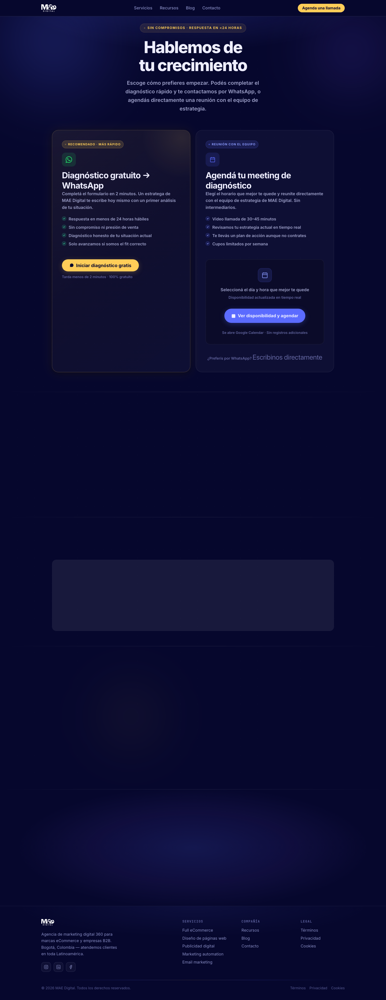

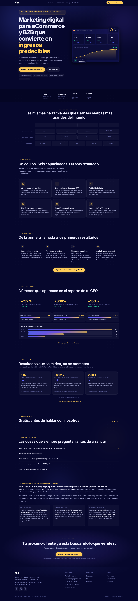

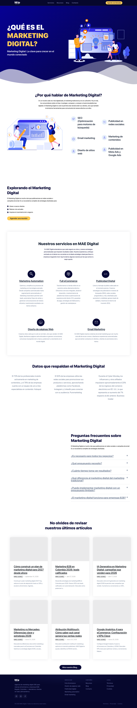

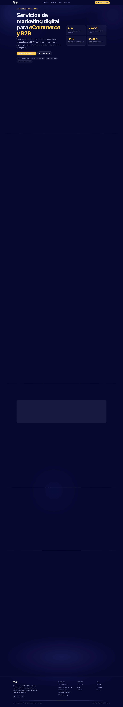

### Section Clips (screens/sections/)

*Clipped individual sections and components*

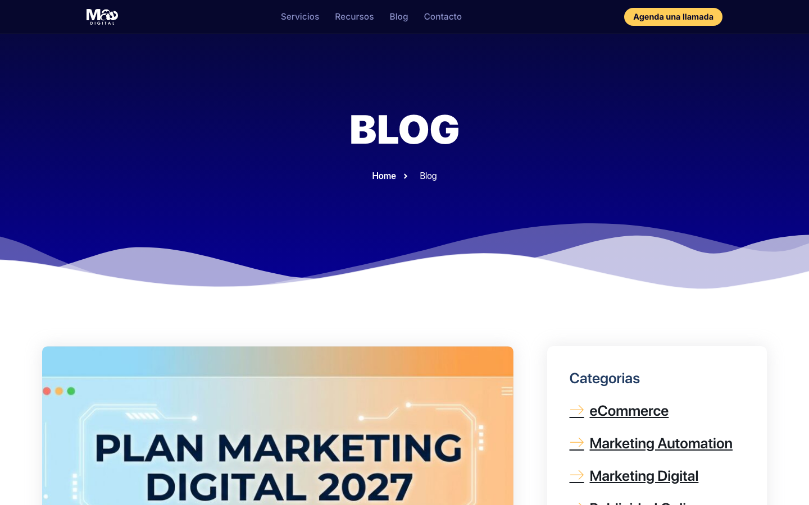

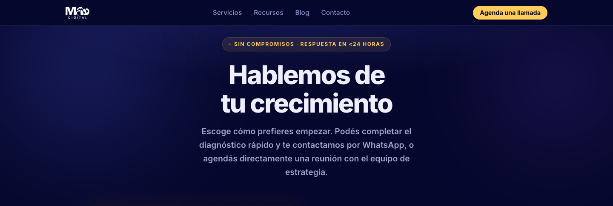


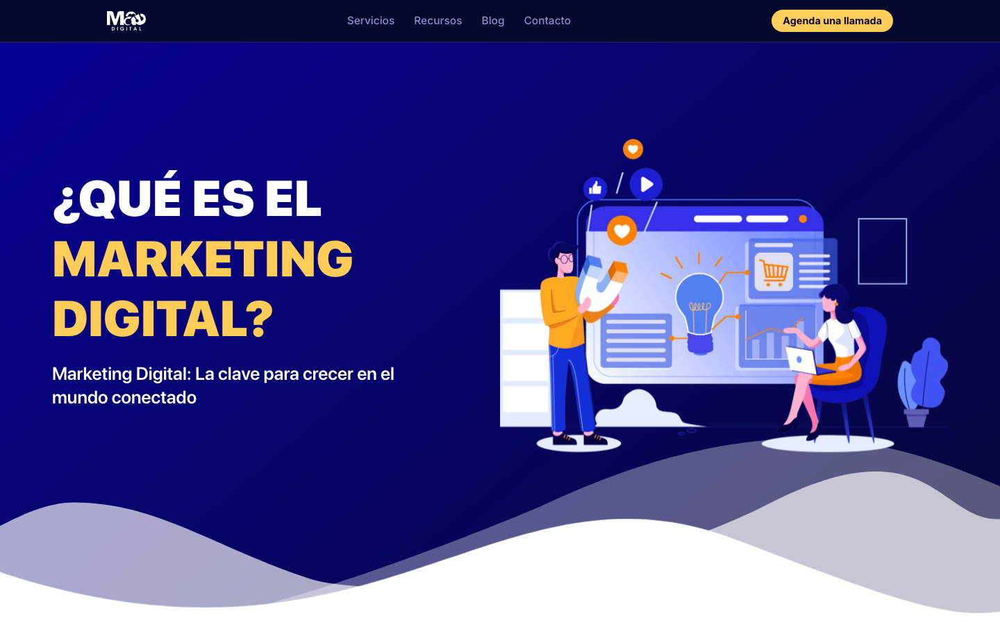

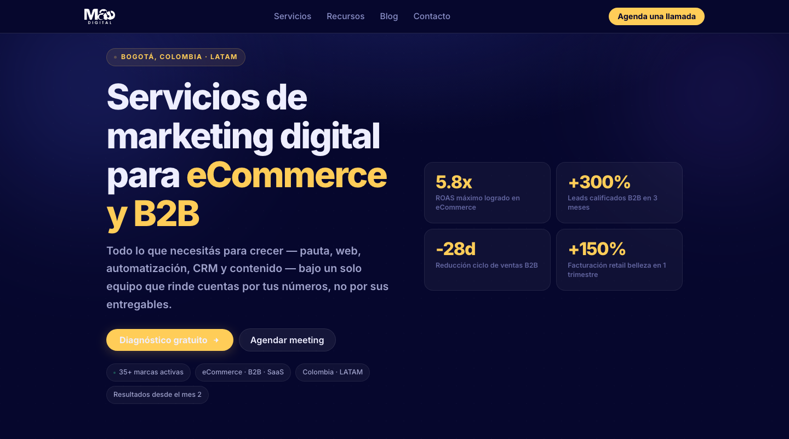


### Interaction States (screens/states/)

*Hover, focus, and active state captures*


### Screenshot Index (screens/INDEX.md)

# Screenshot Index

## Scroll Journey

> Shows the cinematic state at each point of the page

| Scroll | Y Position | File |
|--------|-----------|------|
| 0% | 0px | `screens/scroll/scroll-000.png` |
| 17% | 910px | `screens/scroll/scroll-017.png` |
| 33% | 1767px | `screens/scroll/scroll-033.png` |
| 50% | 2677px | `screens/scroll/scroll-050.png` |
| 67% | 3587px | `screens/scroll/scroll-067.png` |
| 83% | 4444px | `screens/scroll/scroll-083.png` |
| 100% | 5354px | `screens/scroll/scroll-100.png` |

## Pages

| Page | URL | File |
|------|-----|------|
| Inicio - Agencia de Marketing Digital en Colombia | MAE Digital | `https://maedigital.com.co/` | `screens/pages/home.png` |
| Servicios - MAE Digital | Marketing Digital, eCommerce y Soluciones con I.A | `https://maedigital.com.co/servicios/` | `screens/pages/servicios.png` |
| ¿Qué es Marketing Digital? - MAE Digital | Marketing Digital, eCommerce y Soluciones con I.A | `https://maedigital.com.co/que-es-marketing-digital/` | `screens/pages/que-es-marketing-digital.png` |
| Blog - MAE Digital | Marketing Digital, eCommerce y Soluciones con I.A | `https://maedigital.com.co/blog/` | `screens/pages/blog.png` |
| Contacto - MAE Digital | Marketing Digital, eCommerce y Soluciones con I.A | `https://maedigital.com.co/contacto/` | `screens/pages/contacto.png` |

## Sections

| Page | Section | File |
|------|---------|------|
| home | #1 (section) | `screens/sections/home-section-1.png` |
| servicios | #1 (section) | `screens/sections/servicios-section-1.png` |
| servicios | #2 (section) | `screens/sections/servicios-section-2.png` |
| que-es-marketing-digital | #1 (article) | `screens/sections/que-es-marketing-digital-section-1.png` |
| blog | #1 (article) | `screens/sections/blog-section-1.png` |
| contacto | #1 (section) | `screens/sections/contacto-section-1.png` |
| contacto | #2 (section) | `screens/sections/contacto-section-2.png` |

## Homepage Screenshots (screenshots/)


